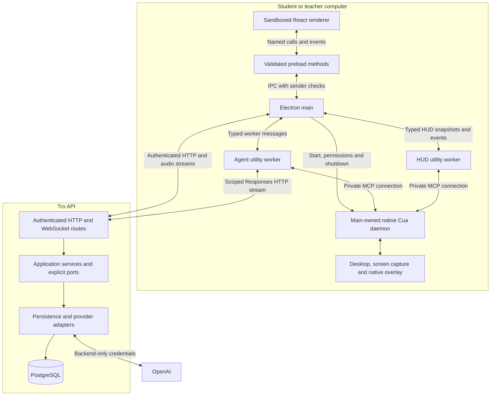
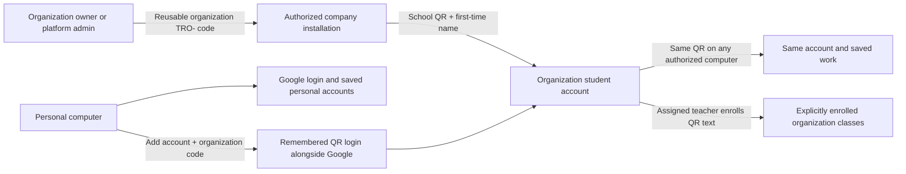
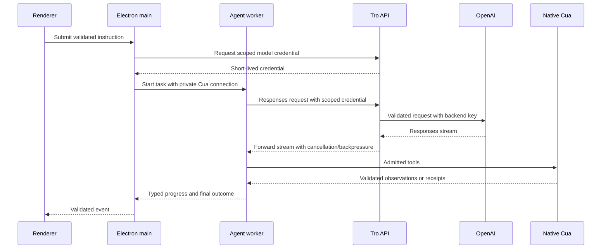
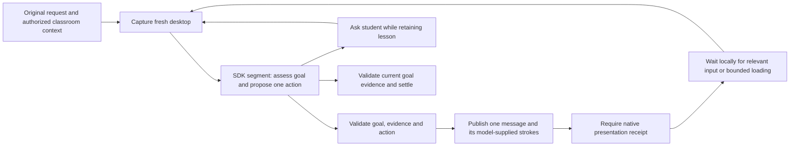
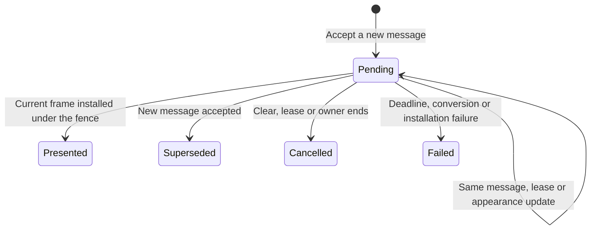
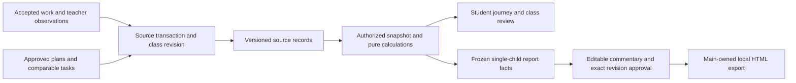

# Tro architecture

This is the single maintained description of Tro's implemented system. Updated
October 15, 2026. Change this document when component ownership, communication or
an architectural invariant changes. Contracts and configuration in the linked code
own exact wire shapes and policy values. Setup and validation commands live in the
[root README](../README.md). Research and UI prototypes are reference material,
not requirements or evidence that a capability exists.

- [System and process boundaries](#system-and-process-boundaries)
- [Authentication and account lifetime](#authentication-and-account-lifetime)
- [Organizations and teams](#organizations-and-teams)
- [Agent requests and model gateway](#agent-requests-and-model-gateway)
- [Teaching](#teaching)
- [Native companion and HUD](#native-companion-and-hud)
- [Voice input and narration](#voice-input-and-narration)
- [Classroom and materials](#classroom-and-materials)
- [Pet World and classroom recognition](#pet-world-and-classroom-recognition)
- [Local presentation and app updates](#local-presentation-and-app-updates)
- [Optional product analytics](#optional-product-analytics)
- [Code ownership](#code-ownership)
- [Verification and current limits](#verification-and-current-limits)

## System and process boundaries

Tro is one pnpm root and a modular monolith. Application code is strict TypeScript.
The desktop uses Electron and React; the API uses Fastify and Prisma/PostgreSQL.
The bundled Cua dependency uses native Rust and platform adapters. It owns screen
capture, desktop tools, input observation and native macOS/Windows compositors. Its native
presentation fence cannot be replaced by asynchronous TypeScript messages.

Main records bounded unexpected child-process exit diagnostics without child names,
URLs, profile data or credentials. [LoadDesktopWindow](../src/desktop/main/LoadDesktopWindow.ts)
retries only development renderer startup when `ERR_FAILED` coincides with a newly
observed Network Service exit. It reloads the same validated document with bounded
attempts and checks shutdown/window lifetime before retrying. Packaged loads and
renderer sandbox settings retain their existing behavior. Navigation failures and
successful recovery have distinct event-driven diagnostics; reading them is
documented in README.

| Boundary                  | Contract and responsibility                                                                                                                                      |
| ------------------------- | ---------------------------------------------------------------------------------------------------------------------------------------------------------------- |
| Renderer ↔ preload ↔ main | Narrow named methods and validated events. Main checks the sender, frame and document. No generic IPC, shell, filesystem or database capability crosses preload. |
| Main ↔ workers            | Validated task, progress, HUD and shutdown messages. Orchestration runs outside the renderer and main UI event loop.                                             |
| Workers ↔ Cua             | MCP tools over a private connection supplied by main. Host lifecycle, HUD and teaching admission tools are hidden from the model.                                |
| Desktop ↔ API             | Versioned HTTP contracts, authenticated sessions and scoped credentials. Desktop sends no database or shared provider key.                                       |
| API ↔ database/providers  | Services depend on application ports; adapters own Prisma, I/O and provider clients. Domain code imports no frameworks or I/O.                                   |

`EmbeddedDesktopDriver` owns one private native daemon shared by task and HUD
connections. A worker closing its connection must not stop that shared host. Main
stops the host when the application quits. Sign-out, account transitions and window
closure dispose the associated tasks and presentation resources. The renderer
stores task messages in memory; general conversation history is not persisted.

The bundled Windows companion uses the GUI executable subsystem to prevent Windows
from allocating a console when the native SDK starts it. Explicit MCP stdio and
parent-liveness pipes remain available. Build and packaging validate the executable's
PE subsystem through `scripts/WindowsCompanionExecutable.ts`; they reject console
builds before staging. This changes window creation, not the driver's telemetry policy.
Native background commands share the core `BackgroundCommand.rs` constructors,
which set `CREATE_NO_WINDOW` before spawning on Windows and preserve pipes and exit
status. Permission and browser inspection, ACL maintenance, browser cleanup and
recording helpers use them. User-requested application launches
retain their separate platform launch path. Both synchronous and Tokio helper tests
run in the native companion regression selection; Windows probes assert that no
console exists inside the child. The Windows suite also launches its own test executable
as a child probe, checking console absence and stdio for both std and Tokio commands.

Windows health and telemetry version diagnostics share `WindowsVersion.rs` in the
native Windows adapter. It uses the generated Windows bindings to query `RtlGetVersion` once in process and returns
major/minor/build without guessing a marketing name or servicing revision. Failure
remains unavailable with a bounded warning; there is no shell fallback. Telemetry
continues deriving only the OS major version from that diagnostic string.
Permission checks keep the upstream external-query workaround: earlier in-process
queries disagreed with observed process integrity. A comparison-only query now
uses the existing primary-token owner, aligned buffer and handle cleanup, and
records bounded parity evidence on explicit permission requests. It never changes
the thread's impersonation or the established permission result. Browser signature
and process inspection keep their existing checks. Cross-platform native tests
cover version formatting/failure and comparison classification; Windows tests compare
the native readings to the existing system commands. README owns the Windows
acceptance steps required before removing the permission workaround.

Main tracks startup stages and reports caught failures through
[DesktopStartupFailure.ts](../src/desktop/main/DesktopStartupFailure.ts). It logs and
persists only the stage and an allowlisted error code, overwriting one local report,
then shows an error dialog before shutdown. This makes failures inspectable without
a console; it does not recover native crashes or failures during module loading.

## Authentication and account lifetime

Hosted authentication trusts the client IP header supplied by Railway's public
HTTP ingress, configured in [AuthDatabase.ts](../src/server/persistence/AuthDatabase.ts).
Public auth traffic must pass through that ingress; clients must not be able to
bypass it and supply their own trusted header. Better Auth uses the resolved IP
for rate limiting, so clients sharing a public IP share an endpoint's limit.
Production requests without a valid trusted IP retain Better Auth's shared fallback
bucket. This configuration does not change account or session authorization.

`AuthClient` opens Google sign-in in the system browser through Better Auth.
Google returns to the backend callback; the backend sends a short-lived code through
`app.tro.desktop://auth/callback#token=…`. Electron main exchanges and verifies it.
The same running instance retains the pending proof-key verifier. Before sign-in,
main registers the protocol and verifies that the OS handler points to that app.

The desktop sidebar is mounted only for a signed-in user. Signed-out and initial
session-loading screens reserve no sidebar space; the welcome screen retains
Google sign-in, saved-account selection, sign-in cancellation, settings and updates.

The renderer restores a session through sequential, bounded status reads while
showing a neutral sign-in check. Only main-classified temporary service failures
and pending status are retried automatically. An expired session ends the check;
storage and invalid-response failures remain visible. An exhausted check offers
an explicit retry without opening Google or discarding saved accounts. The retry
window belongs to `SessionRestorePolicy` in
[UseComputerUse.ts](../src/desktop/renderer/UseComputerUse.ts); an in-flight read
retains main's request timeout. Unmount and account generations fence late replies.

`AccountSessions` emits `auth.session.failed` only for failed verification reads.
Its stage and reason distinguish transport, response reading, HTTP status and
invalid JSON/schema; duration and allowlisted network codes help diagnose startup
ordering. These warnings contain no cookies, response bodies, URLs or profiles.

Saved accounts use independent backend sessions. `AccountSessions` owns selection
and generation guards; `EncryptedAccountVault` stores cookies using Electron
`safeStorage` with atomic replacement. It fails closed when native encryption is
unavailable. Cookies remain in main; only validated profile metadata crosses
preload. Adding or switching an account does not change backend roles.

`User.isAdmin` is a backend-owned flag separate from the student/teacher role and
defaults to false. Better Auth excludes it from sign-up/profile-update input.
Validated session metadata carries it to the desktop, but persisted authorization
is checked again for every admin classroom request; cached profile metadata never
grants access.

The desktop advertises admin-classroom support through the capability header owned
by [Classroom.ts](../src/contracts/Classroom.ts). The API includes the home admin
flag only for clients advertising that capability, so older desktop releases keep
their original strict response shape. This header selects presentation metadata;
it cannot grant admin access. Updated desktops default a missing flag to false
when connected to an older API.

`AccountTransitionGate` excludes account changes from active task, voice,
microphone-test and classroom/material operations. A switch verifies the target
session before selection, detaches the old local classroom binding and clears task,
capture and presentation state. The old account stays signed in and its teacher
session remains stored. Sign-out revokes the selected account's session and removes
its vault entry; other saved accounts remain. Late replies cannot restore an old
identity.

On macOS, main checks Screen Recording and Accessibility before admitting computer
use. The branded development host and installed Tro have different bundle
identities and permission grants. Development also uses the `tro-dev` app name
and separate user/session data paths, isolating its Electron encryption key from
installed Tro. `ConfigureDevelopmentStorage` selects these before readiness in
the main entry; the Finder bootstrap sets them before importing main. Development
never migrates or deletes the installed profile. `DesktopPermissions` requests
access in main so
the OS attributes it to Tro. Missing grants lead to onboarding; no driver task or
model credential is issued before admission.

### Email-free student access

Computer authorization and student identity are separate. Personal computers use
Google and the existing encrypted saved-account switcher. Add account also offers
QR login; an organization code authorizes that personal installation once, and QR
accounts are remembered alongside Google. Company computers are activated once for
an organization, then students log in with their existing school QR cards. A class invitation enrolls an already authenticated Google account; it
cannot activate a computer or sign in a QR student.

[StudentAccess.ts](../src/contracts/StudentAccess.ts) owns the validated desktop/API
commands, computer-code format, capability header and usage replies.
Organization IDs in classroom home replies are advertised only to clients with the
company-computer capability header, preserving older strict response schemas.
[StudentAccessService](../src/server/features/studentAccess/application/StudentAccessService.ts)
owns credential issuance and dispatch through the
[StudentAccessStore](../src/server/features/studentAccess/application/StudentAccessStore.ts)
port. [PrismaStudentAccessStore](../src/server/persistence/PrismaStudentAccessStore.ts)
owns transactions, credentials, quotas and revocation;
[OrganizationComputerAccess](../src/server/persistence/OrganizationComputerAccess.ts)
owns persisted organization administration, QR identity and usage reads.

The organization owner or a verified platform admin explicitly scoped to that
organization creates an organization activation code under Settings → Team → Company computers, without entering a
computer name. Platform admins, including admins who own an organization, must select
that organization before creating/revoking codes or computers or reading usage; Personal
workspace never grants computer administration. The UI hides these controls until selection,
and persistence enforces the same rule inside staff transactions.
Ordinary teachers and students cannot issue codes or view usage.
Codes are short-lived, reusable across the organization's computers and prefixed
`TRO-`; only their digests are persisted. Each successful new activation creates its
own installation grant and generates a distinct name such as Computer 1. Name
allocation, organization capacity, the code's activation counter and grant creation
share a serializable transaction; concurrent activations cannot duplicate generated
names or exceed capacity. Retained installation records, including revoked ones,
reserve their names and count toward the technical installation limit.

A retry with the same activation operation reconciles its existing grant without
creating another computer or incrementing the code's activation count. The issuer
must have current administrative authority for each new activation. This is a separate
persisted-authority check: redemption does not require the original issuer's selected
workspace or live session, but revoked admin/owner authority prevents new activations. Revoking or
expiring a code stops future activations, while existing installation grants and
idempotent activation recovery remain valid under their own expiry and revocation
rules. Revoking a computer disables that installation and its learner sessions
without affecting other computers using the same code. Device authorization also
persists independently of student logins and live classes. Only installation
metadata and counts reach the management UI; active code metadata includes its
activation count even after use. The raw code is shown only when created.

The activation command carries an optional persisted installation mode. Existing
callers default to shared company mode; Add account explicitly requests personal
mode. The encrypted device context and server learner identity validate both modes
within the same organization scope. Replay requires the original mode as well as
the code, request ID and derived credential; an existing company grant cannot be
switched to personal mode by reusing an activation operation.

Company activation requires a clean app profile without saved personal accounts or
an active Google sign-in. The preflight checks this before creating an installation
grant. Personal QR authorization permits saved Google accounts, excludes pending
sign-in/shared-student transitions, and preserves those accounts when adding a QR
login. The returned mode must match the requested mode before main stores the grant.
[EncryptedStudentDevice](../src/desktop/main/accounts/EncryptedStudentDevice.ts)
stores the installation credential using OS encryption and atomic replacement;
it never crosses preload. Google sign-in and saved personal accounts are unavailable
while a company profile is active. Personal QR accounts use independent encrypted
vault sessions with the personal refresh policy; company sessions retain their
memory-only and idle-expiry policy. Revoking either installation invalidates its QR
sessions; unrelated Google sessions remain independent. Signed-out company computers
can remove their authorization, revoking the server grant before deleting local
storage and returning to personal mode. A failed online revocation leaves the local grant available for
retry. A revoked or expired grant cannot admit another student.

The first successful QR login creates one canonical email-less student and an
active Student membership in the organization. The unique organization/card-source/
exact-ID key selects that same account for subsequent sign-ins, including after
sign-out, expiry, restart or using another authorized computer. The stored display
name and work are retained; a new name is needed only on first sign-in. QR contents
are opaque text, including URLs, random values and multiline data. No URL is opened,
no embedded JSON is interpreted and no value can choose a role or organization.
The exact text, including case, leading zeros, whitespace and line breaks, selects
the account; two people presenting the same QR select the same identity. The schema
and text bound are owned by [StudentIdentity](../src/contracts/StudentIdentity.ts)
and shared by login, learner metadata, encrypted vaults and teacher enrollment.
The bound also keeps indexed identity values within PostgreSQL's B-tree entry size.
Empty/whitespace-only, oversized and null-bearing values are rejected. The scanner
emits `student.qr.rejected` once per rejected decode with validation stage, Zod reason
and character count; it excludes the value and pixels. Removed memberships, elevated roles, Google accounts
and other organizations cannot be recovered through this path. No existing users,
work or private Google identities are merged. QR possession is the classroom login
mechanism, not verified school-provider identity: a person with the same QR text
on an authorized computer can access that organization's associated learner account.

Organization membership grants no classroom enrollment. An assigned teacher adds an
already registered QR student by exact QR text or school ID in class settings. Login
works before a live class starts; only explicitly enrolled classes in the current organization are
visible and joinable. Revoking an enrollment stops access to that class without
removing the student's organization account. Removing the student from the team or
revoking the computer invalidates subsequent session, classroom and model requests.
The classroom contract, `ClassroomService` and `ClassroomStore` own QR enrollment,
including the existing capacity and insight invalidation rules; student-access
management does not write classroom enrollment directly.

Company learner sessions remain in memory, end through Change student, idle expiry
or app exit, and are not restored after restart. The encrypted installation grant
remains for the next student. Cleanup clears worker, classroom, capture and renderer
state before another account is selected. An abrupt exit or failed remote logout is
bounded by server session/device expiry. No remote-revocation queue is implemented.
Legacy personal learner accounts retain encrypted saved logins in vault version 2;
re-scanning replaces the same vault entry, including at the saved-account limit.

Usage reports distinguish authorized installations, all registered organization QR
student accounts, distinct students signed in during the current UTC day, and
successful sign-in operations today/all time. Retrying an operation rotates its
credential but adds neither a student nor a sign-in. Repeated new sign-ins add login
events while the student count stays one. Revoked computers and removed students
retain historical usage. These are QR account/installation counts, not verified
people, hardware attestation, continuous presence, Google usage or billing seats.
Technical limits are owned by the contracts and application policy; no commercial
licensing or billing is implemented.

The PersonalOrganizationQrLogin migration permits personal organization grants
without changing existing installation modes, users or work. Admission codes remain
organization scoped; the installation mode controls session retention, never the
student's identity, role or classroom authorization.

The ReusableOrganizationCodes migration relaxes the historical per-code name
constraint without deleting or rewriting existing codes, names, grants, accounts
or usage. Existing unexpired organization codes gain reusable activation behavior;
stored computer names remain unchanged and future names avoid those labels.
Historical per-code labels remain stored for compatibility but are not read by the
current activation or management flow.

The additive OrganizationComputerAccess migration preserves old class grants,
users, sessions and work. Nullable organization scope leaves legacy duplicate claims
unchanged; a new unique organization QR key enforces the new account boundary.
Existing personal-class grants remain readable for compatibility and keep their
class/live-meeting restrictions. Class setup-code issuance, redemption and roster
association commands are retired at the contract, API and persistence boundaries.
Bare class setup codes and class invitations cannot authorize new installations;
new activation accepts only organization-issued `TRO-` codes. Historical roster
records are retained without exposing the old import workflow. Moving a personal
class into an organization revokes its legacy grants; it does not silently
move or merge those learner identities. The historical design is archived in
[StudentQrAccessSpecification](../research/StudentQrAccessSpecification.md).

All writes, including membership, usage and audit records, share serializable
transactions. Conflict classification includes Prisma query and adapter commit
conflicts with bounded backoff. Exhaustion emits
`student.access.transaction.failed` with stage, safe conflict reason and attempt
count. `student.access.failed` records the rejected operation and request ID.
Neither includes QR contents, raw configuration or credentials.

[RegisterStudentAccessRoutes](../src/server/features/studentAccess/infrastructure/RegisterStudentAccessRoutes.ts)
checks the desktop origin and bounds activation/login attempts. Learner cookies
allow only session, classroom learner commands and model-credential access. They
cannot call organization management, teacher/admin, pets, paid voice or transcription
routes, and malformed learner cookies cannot fall back to Google authorization.
Model credentials bind to a learner session; admission rechecks organization,
membership and computer scope and reserves organization/learner daily allowances.
Camera frames are decoded locally by `StudentQrScanner`; manual ID entry is available.
Camera leases end on success, cancel, timeout, unmount or late stream creation.
QR identifiers preserve opaque text, including URLs and line breaks, within the
shared length limit; blank values and NUL characters are rejected. New learner flows
currently support typed lessons; provider roster synchronization, verified school
login, commercial seats and paid voice need separate implementation. Production
retention/consent policy remains a school rollout decision; this local change does
not deploy the app.

[EmbeddedDesktopDriver.ts](../src/desktop/main/EmbeddedDesktopDriver.ts) owns one
unreferenced timer shared by the daemon's subscribers. It checks the SDK's
synchronous `connection()` and generation at a fixed interval; that API refreshes
child exit state before returning. Missing/replaced
connections and read failures invalidate subscribers once. Stop clears the timer
before releasing the host. This avoids the pinned SDK's long-lived asynchronous
exit watcher, whose repeated native callback registrations accumulate memory.

## Organizations and teams

Organizations are backend-owned membership boundaries. Only a persisted platform
admin can approve new owners or transfer ownership. Approval is stored separately
from platform administration and from membership: an approved account can create
its own organization, but cannot appoint other owners. The first-login choice is
owned by [UseOrganizationSetup](../src/desktop/renderer/team/UseOrganizationSetup.ts).
Accounts without a team can continue personally, with that decision saved on the
backend; approved owners can instead create their organization and confirm its
permanent name. Approval is consumed on creation. Repeated creation with the same
owned name reconciles a lost reply instead of creating duplicates. Existing named
members skip the choice; legacy unfinished owners can defer setup and finish later.
Workspace/classroom admission and voice/tours wait for this account-scoped check,
and late replies cannot cross account boundaries. A failed initial check offers
retry/sign-out. A conditional write and database trigger protect permanent names,
including ownership transfers and the legacy rename command.

Settings → Team centers on direct additions and member permissions, with logo and
admin ownership controls collapsed. The current active owner or a platform administrator explicitly scoped to the
organization can add people, change teacher/student permissions or remove members. Verified existing accounts
join immediately; unknown/unverified emails reserve a place in
`OrganizationEmailMember`. Authenticated organization HOME reconciles those records
only with an unambiguous verified account email. Claiming and membership writes
share a serializable transaction; removal or later role edits cannot be undone by
replaying an addition. Owner transfers preserve direct additions as team membership
intent. Owners can edit or remove unclaimed email entries. Active and unclaimed
members share the membership capacity limit. Membership grants no classroom
enrollment or platform authority. The owner must remain an active member.

The additive direct-members migration preserves existing organizations, marks
existing named members' setup as chosen, and converts current unexpired invitations
issued by the current owner into direct email additions. It revokes old unaccepted
codes; expired/revoked invitations remain inactive. Legacy invitation commands are
retained for API compatibility but are absent from current UI. New UI sends no mail
or invitation code. Existing admin provisioning/one-time naming commands also remain
compatible; current owner approval creates no organization until its owner chooses.

Owners can replace/remove their organization's logo after name setup. A local file
picker prepares a static 128-pixel PNG from PNG/JPEG/WebP input before the narrow
organization bridge sends it. The backend independently bounds dimensions, decoded
pixel bytes, PNG checksums and filters, then re-encodes without metadata; SVGs and
remote image URLs are excluded. Prisma stores the image with the organization.
The current active owner or a scoped platform administrator can write it; members receive it through authenticated
organization reads. The compact sidebar shows organization artwork with a Tro badge;
the assistant and app retain Tro branding. Accounts in multiple organizations can
choose sidebar branding independently of classroom access. Platform admin directory
entries without membership do not affect branding. Account changes discard stale
artwork, and logo/membership changes refresh when the window regains focus or the
account signs in again.

[Organizations.ts](../src/contracts/Organizations.ts) owns the strict versioned HTTP
command/reply schemas and limits. [OrganizationService](../src/server/features/organizations/application/OrganizationService.ts)
authorizes operations inside transactions through its store port; the Prisma
adapter owns memberships, email additions and database constraints. Membership
changes are checked against persisted authority on subsequent organization/classroom
requests. Removal preserves history.
It deactivates scoped enrollments and ends the removed member's participations, so
rejoining requires fresh enrollment. Teacher assignments remain historical; restoring
teacher membership restores authority over those assigned classes. Demotion or
removal can interrupt a live class; restoring the assigned teacher's authority is
the recovery path, rather than granting the organization owner classroom powers.

Organization-scoped classes and course revisions store their organization ID.
[OrganizationClassAssignments](../src/server/features/organizations/application/OrganizationClassAssignments.ts)
owns teacher-assignment updates and personal-class linking checks. OrganizationService verifies
ownership and name setup before calling either operation in the same transaction.
The owner-only Team response includes class names, assigned teacher IDs and whether a
session is live, without class content or student progress. Settings → Team → Class
assignments lets the current organization owner select multiple active teacher members
for a class, keeping at least one. `ClassTeacherAssignment` stores the many-to-many
relationship. The additive migration preserves each class's prior teacher, including
personal and historical classes. New classes assign their creator in the same write.
The command checks the organization, current memberships and complete expected teacher
set inside the serializable transaction. Live sessions block assignment changes; old
classroom invitation codes are revoked. Legacy single-teacher commands cannot replace
a class with multiple assignments. The legacy `teacherId` remains a primary-teacher
compatibility field and is not the scoped authorization source. All classroom,
materials, insights, practice and pet permissions check active teacher assignments,
so an unassigned teacher or organization owner gains no content access.

The same panel can explicitly move the owner's own unscoped personal class into the
organization. Its current teacher must be a teacher member, all active enrolled users
must be current team members, no session may be live, and its current course revision
must be unscoped and used by only that class, including historical classes. The class
and course scope change together and prior classroom and QR admission/device codes are revoked; enrollment
and history remain. No class is moved automatically, and other organizations' classes
cannot be moved through this command.
Their materials, practice evidence, insights and class-based pet views retain the
class boundary. Access requires active membership as well as explicit teacher
assignment or enrollment. Teachers can create classes only for organizations where
they hold a teacher role; multiple teaching organizations require a selected scope.
Organization membership alone exposes no classes, submissions or student progress.
Personal accounts and pet entitlements remain personal. Organization QR learners
skip the personal organization-setup chooser and cannot call organization management
endpoints. Their memberships are created only through an organization-authorized
installation login; classroom enrollment remains an explicit teacher action. Legacy personal-class
QR grants remain class-scoped, and moving such a class revokes its old grants.
Platform admins use the organization context described below; they never impersonate a learner.

The additive migration leaves existing classes and courses unscoped, preserving
their global account-role and ownership/enrollment rules. It creates no organizations,
owners or memberships implicitly and does not infer tenant membership from existing
class relationships. Moving historical classes requires the explicit owner flow above; shared-course cases require a separately reviewed mapping.
The renderer has no organization invitation-code state or copy. Direct additions
are the current Team flow; legacy organization invitation commands remain backend
compatibility paths with their existing validation and revocation rules. Classroom
invitations are a separate enrollment workflow and remain unchanged.

The global `User.role` and operator role command remain for those legacy resources;
organization owners change membership roles only. Classroom home metadata negotiates
teaching-organization choices and class teaching permissions separately so older
strict clients retain their shape. Classroom and Pet World controls use the selected
class's permission, rather than applying an aggregate teacher role to every class.

Electron main owns organization HTTP cookies. [RegisterOrganizations](../src/desktop/main/organizations/RegisterOrganizations.ts)
checks the IPC sender, verified session and expected account ID while holding the
account transition gate. Preload exposes only the validated organization command
capability. Settings requests use the actual signed-in identity and selected admin organization;
the renderer discards replies from stale account and organization generations.

## Agent requests and model gateway

The desktop labels this surface **Trò chuyện / Conversation**. `ComputerUsePage`
displays the current in-memory exchange and marks submitted voice messages from
existing events. `ConversationVoiceStatus` presents the app-owned voice status and
partial transcript without adding subscriptions or capture controls. It does not
provide saved conversation history or change the cursor-following HUD.

Typed instructions and completed voice transcripts enter `AgentChatController`.
Main checks account, permissions and exclusivity, obtains a scoped model credential,
and sends one task to the utility worker. With the native companion, the local
following worker stays connected while the signed-in window is open. The fallback
worker starts on demand and retains a bounded warm lifetime after a task. Every
settled follow-up starts a fresh task; an active teaching lesson retains its own goal.

The gateway is split by responsibility: `RegisterModelGateway` owns routes,
`ModelCredentials` scoped authentication, `ModelRequest` admission,
`FetchModelResponse` bounded fetch recovery, and `ForwardModelResponse` streaming.
`ModelGatewayConfig` owns the model, output ceiling, body limit, credential lifetime,
timeout and retry policy; backend `Env.ts` owns validated secrets.

Assistant requests have no input-token counting preflight and no daily model request
cap. A rejected fetch before headers may retry once, only for the configured socket
codes, under the same cancellation/deadline. HTTP errors, other network errors and
post-header failures are not retried. SDK automatic retries are disabled. Desktop
tools are never replayed by transport recovery. A pre-header retry can still incur
another inference charge because provider execution may be uncertain.

The worker's logged fetch gives each model request a random UUID, sent in the
validated `x-tro-model-request-id` header. The gateway echoes that ID on successful
streams and failures, including pre-admission errors. Worker events retain task,
role and attempt context; teaching segments use their lesson ID as the task ID.
Gateway events share that model ID and the local gateway request ID. Untrusted
trace headers are discarded, and the header is not forwarded to the provider.
Each upstream attempt independently generates a UUID `providerClientRequestId`
and sends it as `X-Client-Request-Id`. Started and settled attempt events share
that ID; retries receive a new one. Final error diagnostics and stream events
retain the relevant attempt ID. It permits provider-side receipt lookup when a
disconnect prevents receipt of the provider's response ID, without exposing input.

`ModelTransportObserver` observes each fetch attempt through Node's Undici
diagnostic channels. Request identity scopes events after dispatch; sockets have
opaque local connection IDs and observed use counts. It records assignment,
local byte-counter changes, body-write completion, response-header arrival,
socket closure and allowlisted public TLS state, with at most 16 stage timestamps.
The connected socket's address family is retained without its address; a proxy
socket's family does not establish the provider's address family.
Snapshots freeze when fetch resolves or
rejects; temporary socket listeners are removed then. It changes no dispatcher,
pooling, retry, TLS or timeout behavior and reads no headers, request bodies,
addresses or secrets. A body-sent event establishes local queuing/writing, not
provider receipt or execution. Missing observations remain explicit.
The observer also retains the first allowlisted socket error independently of
the fetch rejection. A TLS alert can otherwise be replaced by a later
`UND_ERR_SOCKET` or `EPIPE`. Failed attempt events and the final gateway failure
include that bounded `socketFailure` summary, including safe TLS alert numbers.
It remains API-log-only, contains no native error object or message, and does not
change retry eligibility. Listeners and observations stop when the attempt settles.

The route logs `model.gateway.request` before body parsing, then admission or a
rejection. Forwarding logs dispatch, each attempt, provider headers and the first
response chunk. Completion or failure includes aggregate bytes, chunks, first/last
chunk latency and backpressure waits. `model.gateway.aborted` records the first
local cancellation source, client or deadline. `model.gateway.delivered` records
the local HTTP response finish; it does not prove the desktop received all bytes.
These events contain no HTTP bodies, screenshot pixels, credentials or headers.

Bounded `model.gateway.attempt` events include gateway request ID, attempt number,
phase, request byte count, timing, cancellation status, retry decision and the
transport snapshot. Failure summaries and the HTTP error envelope retain the
final attempt snapshot and a conservative failure stage. A recorded second use
establishes reuse; a connection established during this attempt establishes new
use. Otherwise connection use remains unknown. Compare connection IDs across failed
attempts; lifetime
socket totals alone cannot identify the failing request's upload. These diagnostics
do not establish why a remote peer closed. Local loopback checks exercise real
fetch peer-close recovery without credentials, a model call or user screenshots.
The failure lab compares local transport observations with independent peer byte
counts for interrupted uploads, closure before headers, malformed HTTP, provider
rejection, truncated streaming, client cancellation, deadline expiry, TLS setup
failure and successful fresh/reused connections.

`CheckModelConnection` separately probes current DNS/TLS/HTTP reachability with
credentialless GETs to the fixed provider models endpoint. It compares repeated
native fetch and fresh IPv4/IPv6 HTTPS connections under bounded deadlines and
response sizes. The script's validated environment reader records only proxy,
CA and TLS-override flags; macOS system proxy values and DNS addresses are
discarded. Safe socket/TLS failures remain allowlisted. These small requests do
not establish large authenticated upload stability or the earlier disconnect's
cause. Different fetch/HTTPS proxy routes and unavailable IPv6 remain explicit
limitations. Commands and report paths belong in README.md.

| Failure stage                      | Evidence established by the log                                                                                                                        |
| ---------------------------------- | ------------------------------------------------------------------------------------------------------------------------------------------------------ |
| `before_connection`                | No provider socket was assigned; the safe cause may identify TLS or connection setup failure.                                                          |
| `upload`                           | A socket was assigned, but body writing did not complete before the observed socket closure. A later body-sent callback does not change that evidence. |
| `waiting_for_headers`              | Local body writing completed, but no valid HTTP response headers arrived. This does not prove provider receipt.                                        |
| `provider_response`                | Valid provider HTTP headers arrived; status and allowlisted rejection fields identify its response.                                                    |
| `response_stream`                  | Response headers arrived, then reading or forwarding the body failed.                                                                                  |
| `client_disconnected` / `deadline` | The first local abort source identifies desktop disconnection or the gateway deadline.                                                                 |
| `unobserved`                       | Transport observations were unavailable; the log does not invent a stage.                                                                              |

Development-only `companion.hud.transition` events identify the previous and next
phase, event source/cause and available task/capture/lesson IDs. Only phase changes
are logged, and no message or transcript enters the event. A failed diagnostic
callback cannot prevent the HUD from rendering. These logs locate the event that
displayed an error; they do not determine the network peer's reason for closing.

Execution tasks use `TaskHarness`, `MainAgentRunner`, `TaskVerifier` and
`CompletionGate`. The harness owns immutable request/goal state, budgets and final
settlement. The actor explicitly requests a separate read-only verifier. Both agents'
actual observations are retained in bounded task memory. The gate checks criterion
coverage, provenance, age and supersession before accepting the stored verdict.
A bounded continuation can retain the original task history. Desktop tool use
cannot bypass verification through a prose-only response. Public outcomes distinguish
succeeded, partial, blocked and unverified; these checks validate evidence wiring,
not the correctness of every model judgment.

## Teaching

Show me keeps the student's original goal and lets the student control the real
pointer. `TeachingTaskRunner` owns SDK segments, questions, local waiting and
cancellation. `TeachingLessonContext` owns the current goal, checkpoints, proposal,
assessment and localized instruction. `TeachingPresenter` is the only paired
instruction/drawing presentation path.

The model defines or explicitly revises a typed teaching goal, then proposes one
reachable action through `present_teaching_step`, together with an explicit nullable
[drawing](../src/contracts/TeachingDrawing.ts). Spatial actions require bounded
model-supplied stroke points in the same normalized coordinate system as action
target boxes. The native host smooths and animates these paths. Action bounds alone
supply student input matching; decorative stroke bounds never become click targets.
Keyboard, focused typing and loading actions require a null drawing and an explicit
text-only receipt. The final decision references the presentation rather than
introducing another unacknowledged instruction.

The drawing contract owns point limits, closure rules and host presentation policy.
It rejects nonfinite, out-of-range and degenerate paths. Coordinates are normalized
fractions of the bound screenshot, with a top-left origin, X increasing rightward
and Y downward. Capture ownership, screenshot pixel dimensions, logical display
dimensions, scale and capture options remain attached to that observation. The
worker passes the validated points unchanged; the native compiler maps them to
logical display points once, and the platform adapter owns compositor origin,
Y-axis and backing-scale conversion. Attachment previews and guessed window sizes
do not supply drawing geometry.

`LoggedCuaServer` restricts model tools, binds the lesson and pins drawing version 3.
Host-generated epochs and presentation IDs cannot be overridden by the model.
The private native `present_teaching_guidance` tool compiles the bound capture's
stroke geometry once, refreshes the screen locally, compares action target boxes
and stroke-covered regions, then renders that same compiled plan. It refuses
changed targets, input or display geometry without comparing an entire long path's
bounding rectangle. The worker does not make a separate refresh dispatch or model
call. A stale screen returns bounded repair feedback; unknown transport outcomes
are terminal and are not replayed.

A paired receipt requires the current HUD message and actual drawing installation.
An uninterrupted presentation must cover every requested stroke with full reveal
and the required visible hold. An interrupted presentation reports only strokes
that appeared, with their actual progress. The
[receipt validators](../src/contracts/CursorCompanion.ts) bind the epoch,
presentation, lesson and step, and check unique in-range stroke indices. An
interrupted spatial receipt requires an installed nonempty stroke; interruption
before visibility and interrupted text-only presentations cannot report success.
Pointer-only and clear-only frames cannot count as spatial guidance. Teaching uses
one scribble renderer and one supported presentation protocol; incompatible drivers
fail admission.

In the native companion, `ScribbleRenderer` owns curve compilation and bounded
playback timing. A pair of points forms a straight segment; longer open paths and
closed loops use midpoint-based quadratic smoothing. Open endpoints are retained,
loops close continuously, and redundant neighboring points are removed without
moving the target. The compiled path supplies rendering, stroke comparison coverage
and diagnostic bounds. Reveal follows distance along that path; styling, round caps
and joins, reveal and hold timing belong to the host. Reduced motion skips
progressive reveal while retaining drawing installation and visible-hold evidence.
`TeachingGuidanceAdapter` joins capture comparison and paired presentation;
`CompanionSession` retains session ownership and cursor following.
`TeachingPresenter` binds pending narration and input matching to the current
segment. Closing a segment revokes its pending presentation, ends the native epoch
and drains outstanding calls. A late response cannot commit or clear a newer step;
an already committed receipt remains available to the runner.

Both native MCP transport paths admit companion stop, teardown, lease renewal and
bounded HUD controls outside the desktop action queue. A reader-owned FIFO queue
starts one drawing or ordinary executor request at a time. Controls use the same
argument validation, transport session identity, authorization and ownership
checks, so cancellation can invalidate a pending drawing without waiting for its
playback to finish.
Disconnect discards queued calls and retires the connection's transport owner at
core session admission. A delayed first request cannot create a new session after
that owner has closed.

`DesktopObservationClient` and `TeachingObservationPolicy` read the session-owned
native watch and structured input history. Settled clicks, keys and scrolling can
resume the same lesson; passive pointer movement and unrelated animation do not
schedule inference. Loading and target appearance use bounded observation. Failed
comparisons are feedback in the same SDK history within a shared repair budget.
Fresh capture references are required for current goal criteria.

Click/key/scroll during a drawing interrupts that preview and returns to observation.
Esc cancels the entire lesson, releases its watch/epoch and prevents later input from
resuming it. Native presentation or transport failures end the task with a typed
reason. Demonstrated teaching is separate from independently verified desktop
execution and from classroom assessment.

## Native companion and HUD

`DesktopCompanion` composes cursor following and HUD presentation in main.
`CompanionHudController` reduces voice/task events; `CompanionHudClient` owns a
separate persistent presentation worker. Both task and HUD workers use main's
shared native daemon. Private group registration and bounded leases bind only the
associated cursors; host HUD tools are excluded from model discovery and dispatch.

The native presentation owner is `HudState` in the pinned
[CursorCompanion.patch](../driver-patches/CursorCompanion.patch). One immutable job
owns the message, render token, deadline and watch-channel outcome. The token
contains an owner epoch, increasing revision and render ID. The painter projects
accepted messages; it makes no independent message admission decision.

| Operation             | Invariant                                                                                                                                                                                                                                   |
| --------------------- | ------------------------------------------------------------------------------------------------------------------------------------------------------------------------------------------------------------------------------------------- |
| Admission             | Validate live owner, lesson and sequence before changing message or receipt. Exact duplicates reuse token, waiter, deadline and outcome. Older messages and equal-identity content conflicts cannot replace the current job.                |
| Lease / appearance    | `CompanionHudPublisher` serializes explicit `renew_lease` and `update_appearance` commands. They carry no cached teaching message. Only these intents coalesce; message/clear ordering is preserved.                                        |
| Render and install    | An immutable scene/message token travels through painting, conversion and the main-queue mailbox. `install_current_composite` validates it while holding the same HUD fence across synchronous CALayer installation and receipt completion. |
| Clear / failure       | Token-conditioned cleanup cannot clear a newer job. Watermarks survive clear/failure. Watch outcomes become terminal once; late callbacks cannot turn an old terminal job into Presented.                                                   |
| Lesson / owner change | Explicit lesson binding and owner retirement invalidate old scenes. Retired lesson identities and cursor bindings are bounded. Delayed readback cannot replace newer observed tokens.                                                       |

The installation guard also fences empty composites and obsolete drawing frames.
Current Presented jobs may animate without completing their receipt again. The
lock order is HUD → unique guidance fences in pointer order → accessibility text;
the callback does not await or acquire the render-controller lock. Coalesced or
rejected images are released. The original one-second message deadline remains.
Presented means CALayer or the Win32 layered window accepted the current frame,
not physical display scan-out.
A message receipt alone does not satisfy a spatial teaching presentation.

Settled HUD messages and stationary following cursors do not continuously publish
or rasterize full-display images. Lightweight maintenance still checks leases,
presentation deadlines and pointer movement; active cursor/HUD animations and
drawing receipts retain their frame updates. Recurring macOS render/follow work
drains scoped autorelease pools so temporary Cocoa objects do not accumulate over
the lifetime of a background thread. These changes reduce idle work; they do not
impose an OS memory limit on the desktop process tree.

Common admission, explicit refresh commands and the installation fence keep HUD
messages and receipts under the same owner. Native build provenance and the required
app/driver pairing are owned by
[CuaCompanionBuild.ts](../src/contracts/CuaCompanionBuild.ts).

### Maintaining native driver changes

Tro maintains its native Cua customizations in
[CursorCompanion.patch](../driver-patches/CursorCompanion.patch), applied to the
pinned public upstream source during the build. The patch is the maintained
source for these customizations; temporary upstream checkouts and cached
executables are build artifacts.

Changes to Tro's TypeScript/React behavior do not require a native patch update
unless they change the native tool contract or behavior. Changes to cursor
rendering, drawing playback, native HUD presentation or OS input observation must
update the patch in the same change. Edit and test the Rust files in an upstream
checkout at the pinned commit, then regenerate the complete patch against that
commit, including all existing Tro customizations and new files. Do not replace
it with a diff against an already patched checkout.

Keep the patched Rust workspace version and lockfile aligned with the required
version in `CuaCompanionBuild.ts` when changing the native build. An upstream
upgrade must also align the source commit, fetch tag in
[BuildCuaCompanion.ts](../scripts/BuildCuaCompanion.ts), and patch base; resolve
conflicts while preserving Tro's contracts. Review both platform adapters whenever
shared native contracts change. Rebuild and verify the affected platforms before
shipping, then restart Tro to load the new executable. Packaging verifies source,
patch and executable provenance and rejects a stale cached build. README owns
the build, restart and validation commands.

A diagnosed gateway HTTP 502 with `provider_network_failed`, SDK connection or
timeout errors, and validated temporary provider 500/502/503/504 responses pause
the teaching lesson for an explicit student retry, as do model-access errors.
The original goal and session stay in memory and the hold shortcut remains
available. The HUD shows input readiness; `agent.teaching.model_retry.paused`
retains safe gateway correlation and the retry reason. No automatic model loop
is added. Cancellation, unclassified HTTP 502, permanent provider rejections
and native failures retain terminal behavior.

## Voice input and narration

During local teaching waits, the worker explicitly advertises `canAcceptAnswer`
with WAITING progress. Main allows the hold-to-speak shortcut and routes the
follow-up into the same lesson, just as for a question; it does not cancel or
replace the original goal. Presentation acknowledgements alone do not advertise
this readiness while the model is still deciding. The lesson accepts one pending
follow-up and closes admission before the next observation/model segment. Voice
returns to RUNNING when input readiness closes and IDLE when it opens, without
requiring Escape.

A failed follow-up voice capture releases its capture identity and returns to
IDLE while the active lesson admits answers; it returns to RUNNING when the
lesson is busy. Canceling that capture does not invalidate the original lesson's
eventual outcome. Account invalidation still fences all pending submissions.
The HUD preserves the active lesson on follow-up voice failure, briefly shows
ERROR, then returns to NEEDS_INPUT. Its timer is canceled by newer input/progress
or Escape so a late reset cannot overwrite the current state. Fatal task errors
still settle the task and release controls.

`agent.teaching.student_input.admission` records lesson identity and acceptance,
without speech content; local waiting events include input readiness.

The held shortcut is Command + Control on macOS and Control + Left Alt on Windows.
The native key listener owns press/release/rearming. `VoiceInputController` owns
capture identity, account checks, cancellation and exactly one final instruction
submission. The sandboxed renderer owns microphone tracks and an AudioWorklet.
Named preload methods carry bounded sequenced PCM frames to main.

Main's authenticated transcription WebSocket relays audio through the API to
OpenAI live transcription. One provider session is created per capture. On release,
the worklet flushes its tail; main/relay enforce sequence order before commit and
correlate the final transcript to the committed item. Partial transcripts do not
start agent tasks. Release stops tracks immediately; bounded buffering allows
already captured speech to finish while the connection opens. Esc, account/window
changes, sleep/lock or failure invalidate late finals. Voice capture stops between
holds; the open microphone picker has a separate local-only input preview.

`Microphones`, `MicrophonePicker` and local preferences own input selection.
Automatic selection follows OS routing; explicit selection uses exact constraints
and fails visibly if missing. Suggestions are name-based hints. Ranking does not
switch the selected route. Local quiet/speech comparisons use a main-owned exclusive
lease, compute scalar measurements and stop every track. Test audio is neither
uploaded nor saved. Opening the picker automatically previews the selected input,
including OS routing for Auto-detect. Changing the selection releases the previous
capture before opening the new route. The preview worklet emits only short-window
RMS levels at most ten times per second, with no transcription or retained audio.
The renderer renews the main-owned preview lease while the picker remains open;
an expired or rejected renewal stops capture. Closing or hiding the picker,
signing out, a device change, sleep/lock or a failure clears the bar and stops tracks.
Visible, eligible pickers resume after visibility/device changes. Guided six-second
comparisons remain explicit and use exact inputs; starting one releases the preview
first, then the preview resumes when the comparison ends or is canceled. Hold-to-talk
is excluded while the preview or comparison owns the microphone. Transcription usage
reservations and active captures are persisted through the backend allowance adapter.

HUD narration is a separate flow: installed native message readback →
`VoiceoverController` → authenticated backend OpenAI PCM speech stream → bounded renderer
playback → speaking acknowledgments back to main/HUD. The backend owns voices,
model settings, credentials and paid allowance. The speech adapter uses the same
backend-only `OPENAI_API_KEY` as the other OpenAI features;
`VoiceoverConfig` owns the model, voices and locale-specific reading instructions.
Raw 24 kHz mono PCM preserves the existing playback contract. Speech stops before microphone
capture and on context/account/window changes. Failure leaves visual guidance
usable. Playback and speech are not completion evidence. English/Vietnamese locale
is snapshotted for the operation. Live provider pronunciation and signed hardware
acceptance remain separate checks.

## Classroom and materials

Classroom authorization lives in `ClassroomService` and its store port. Teachers
and students are real signed-in accounts with backend-owned roles. Invitation/enrollment,
live session availability, explicit joining, presence, progress and hand-in are
separate facts. Sessions expose Explanation, Practice, Submission and Review;
teacher-paced sessions bind the current activity, while self-paced sessions allow
student selection. Class detail routes remain inside the installed renderer's hash
router; a route does not authorize class access.

Platform administrators (`User.isAdmin`, separate from teacher/student roles) select
an organization in the workspace-wide admin selector. The signed-in user remains
the actor for every operation; no member session, membership or ownership is created.
[AdminOrganizationController](../src/desktop/main/organizations/AdminOrganizationController.ts)
keeps the selection in main-process memory, validates selection through the organization
API, and attaches the contract-owned scope header only to organization, classroom,
materials, practice, insights, lesson-video, Pet World and student-access transports.
[RegisterAdminOrganization](../src/server/auth/RegisterAdminOrganization.ts) checks the
persisted admin flag and organization on every scoped request. Its AsyncLocalStorage
context preserves the actor and organization across that request's async operations,
with independent contexts for concurrent requests. It never changes the authenticated
user ID. Persistence adapters consume that context; application services receive
explicit authority through their existing store ports. Teaching/member authority is
rechecked inside transactions, including after revocation.

Scoped admins can manage the selected team's membership, logo and teacher assignments,
and use the existing teacher screens for every class in that organization. Class and
course listings are scoped; cross-organization IDs do not grant authority. New classes
require an active teacher selected from that organization. The real teacher owns the
class/course; admin auditing retains the initiating actor. Existing class ownership and
teacher assignments are preserved during administrative edits. Insights, practice
reviews, material preparation/publication and classroom recognition use the same scoped
class authority. Lesson-video reads and edits can include another teacher's jobs only
when their class is in the selected organization; creator IDs and usage allowances are
preserved. Personal resources and credentials keep their existing ownership. Naming,
capacity, live-session, concurrency and enrollment invariants still apply.

Switching uses the account transition gate, clears participation, prepared work,
insight/export and Pet World state, and aborts old scoped requests. Authenticated work
and active agent/voice tasks prevent switching. Renderer pages remount by account and
organization, hiding the old workspace during transition. Failed selections preserve
the previous scope. Returning to Personal workspace needs no server authorization;
account changes and app restarts clear selection. The old person picker and transport
are removed; legacy impersonation headers and commands are rejected. Legacy read-only
admin class APIs remain for older clients and respect a supplied organization scope.
Completed administrative operations log actor/organization IDs, operation, route,
request ID and status in `organization.admin.completed`, without content or credentials.
Outside an explicit admin scope, Classroom lists the classes the account teaches or
has joined across organizations; the sidebar brand selection does not filter that list.
Teacher and student class cards and detail panels label the class's persisted organization,
or Personal for an unscoped class. The classroom store reads each visible class's organization
relation; names are sent only to clients advertising the organization-label capability,
preserving older strict response parsers. When an older API omits the name, the
renderer resolves the class organization ID against the current account's organization
directory or teaching organizations. It never substitutes the selected sidebar brand
or guesses an organization for personal classes.
Teacher accounts can still choose between classes taught and classes joined; enrolled
class routes open the student panel. Administrators never take over student device leases.

`ClassroomSessionController` loads fresh authorized context for each class-bound
Show me request, including pinned course revision, stage, activity, criteria,
working resource and durable student progress. Joined classroom Do it for me
requests are refused. Rejoining restores participation and work; device leases
prevent another device from writing with old authority. Context/version checks
fence late commands. Esc cancels guidance without leaving the class. Switching
accounts or quitting disposes local task authority without leaving the classroom.
The desktop restores the signed-in student's existing live participation from the
backend, renewing its device lease. An explicit Leave ends participation; a teacher
ending the session or revoking enrollment prevents restoration. Device takeover
still fences the previous device, which does not automatically reclaim authority
until its next account lifetime.

Teachers upload originals, prepare suggestions, edit review and explicitly approve.
`MaterialService` owns collection versions and approval; `MaterialPreparationRunner`
and `PrepareMaterialCollection` own durable extraction, document briefs and composition.
Provider/extractor/storage adapters operate behind ports. Class-scoped derivation
claims and cache keys permit reuse of unchanged work. Each uncached preparation
stage counts input tokens and reserves its job allowance before generation; this
is separate from assistant gateway forwarding. Uncertain provider outcomes require
explicit retry. A bounded citation repair validates referenced source ranges.

```mermaid
flowchart LR
  Originals[Teacher uploads and instructions] --> Extract[Extract exact source units]
  Extract --> Briefs[Reusable document briefs]
  Briefs --> Compose[Class overview and suggested sections]
  Compose --> Review[Teacher edits and approves]
  Review --> Revision[Immutable published course revision]
  Revision --> Packet[Authorized bounded student context]
  Packet --> Tutor[Existing Show me teaching worker]
  Tutor --> Sources[Authenticated source search and reads]
  Sources --> Tutor
```

Originals, exact text, document briefs and teacher corrections remain distinct.
Review revisions reuse extraction/briefs where inputs are unchanged; they do not
approve automatically or alter a live session's pinned publication. Student material
packets select dependencies, corrections and relevant passages under a token budget.
`ReadMaterialSources` supplies authorized bounded search/reads; missing required
context is reported rather than silently shortened. Legacy publications use a
compatibility adapter. Preparation limits and provider settings belong in backend
`Env.ts` and the owning preparation modules.

An assigned teacher can delete an inactive class through a confirmed command. The
serializable transaction rechecks that no live session exists, tombstones the class,
revokes invitation access and preserves work/history. Removing a material deletes
unused originals but preserves files referenced by immutable approved revisions.
Neither operation resets the database or rewrites applied migrations.

### Practice checks

`PracticeCheckService` owns student authorization, admission budgets, immutable snapshots,
idempotent checks and independently confirmed hand-ins. It delegates assessment through
an application port. `PracticeAssessmentService` prepares evidence and batches criteria
by their teacher-approved verification method. `PracticeCriterionEvaluator` is the extension
point; the Responses adapter, exact supplied-text comparison and connected Scratch block
checker implement it. Missing required class sources, unsupported evidence capabilities
(including verified execution) and teacher-only criteria produce insufficient evidence.
There is no implicit fallback from an approved deterministic rule to an LLM.

`PrismaPracticeCheckStore.readGrounding` resolves the pinned course publication and rubric
source IDs into passages and teacher corrections. Each grounding source retains both its
passage ID and source-unit/page ID so criterion references remain traceable. `ExtractPracticeArtifact` reuses the
bounded material parser worker for PDF text and static sb3 target graphs. Pasted code is
text evidence; it is never executed. PDF layout/scans and Scratch runtime behavior require
additional evidence or teacher review. Extraction is separate from judgment. Saved checks
include extractor/evaluator versions, source IDs, warnings and derived units tied to original
evidence IDs. These private units are scrubbed with the original work on removal/expiry.
The offline quality runner in `test/server/features/classroom/evaluation` measures disagreement,
false passes, missing results and invalid citations. Synthetic test cases verify the runner;
real teacher-reviewed reference labels and live-model calibration remain release work.

`PracticeCaptureController` owns expiring local drafts bound to the joined device and current
activity/attempt/context/progress versions. Its Electron adapter lists opaque window choices,
excludes Tro windows and captures the selected window. Electron enumerates window thumbnails
locally; only the selected image is retained. It does not capture entire displays. The student
reviews the image before explicitly sending it. Command + K on macOS and Alt + K on Windows
capture the remembered selection before focusing Tro; first use opens a window picker.
Manual text, supported images, PDF and sb3 uploads remain available. Capture provenance records
time, dimensions and a digest, not proof of authorship or execution. Preload validates narrow
capture commands/replies; main rejects changed or expired captured evidence.

While idle, the native HUD shows Command + K on macOS and Alt + K on Windows beside
Check work / Kiểm tra bài when the joined Practice activity has an approved checkpoint
and its global shortcut is registered. `CompanionHudController` owns the display-only
practice-ready phase; active voice, teaching and evaluation take priority. The hint returns
after transient status fades and clears on eligibility loss or presentation reset. The
shortcut opens capture/review; it never confirms hand-in.

The HUD uses the request locale for Checking… / Kiểm tra…, feedback ready,
submission and failure phases. Request IDs, history matching and a bounded presentation timer
fence late replies. Active voice or teaching guidance retains HUD priority; the practice panel
still displays check progress. A successful check is formative feedback, never a grade.
Students can request teacher review tied to an authorized saved check and criterion through
the existing insights help queue. Teacher results retain the original evidence and hand-in
receipts; hand-in remains a separate confirmation of the exact checked version. Both practice
review and the Insights work gallery offer original-file downloads for PDF and sb3 evidence.

### Learning history and parent reports

[ClassroomInsights.ts](../src/contracts/ClassroomInsights.ts) owns strict source,
command, read and report schemas. [ClassroomInsightService](../src/server/features/classroom/application/ClassroomInsightService.ts)
authorizes the versioned insights endpoint. An assigned teacher can read retained
class history and approve plans, comparable tasks, observations and parent reports.
Student reads require current enrollment and return that student's progress and
assigned plans. Help requests additionally require main's private joined-device
binding, a current lease and the permitted live Practice activity.

Learning insights are always available for authorized classes. [Backend configuration](../src/server/Env.ts)
provides the collection-policy identifier and a rolling retention duration, with a
default classroom learning policy and 180-day retention. No class allowlist is required.
`PrismaClassroomStore` and `PrismaPracticeCheckStore` append accepted progress,
confirmed snapshot/link hand-ins, check admission and terminal results inside the
source transaction. Rejected or stale writes cannot create a learning event.
New link hand-ins pin the task's accepted course revision; imported links with no
known revision retain that unknown context.
This captures explicit work and requests; it does not measure attention, keyboard
activity, motivation or the delivery of native tutoring assistance.

[AppendClassroomLearningEvent](../src/server/persistence/AppendClassroomLearningEvent.ts)
allocates the class revision and saves an immutable event plus a versioned record.
The additive Prisma tables index class, child, kind and revision; their JSON values
must validate against the discriminated source schemas. Evidence bytes stay in
the existing private snapshot store. Plans, skill standards and task variants are
approved definitions. Historical mapping versions remain available, and an
assessment pins the exact mapping, course and rubric it used.

[PrismaClassroomInsightStore](../src/server/persistence/PrismaClassroomInsightStore.ts)
owns consistent complete metadata reads, scoped pagination, private evidence and
compare-and-set writes. Serializable reads, source writes and retention use bounded
conflict retries, including driver failures reported during commit. Read limits are
declared by `InsightLimits`; exceeding a
budget refuses the query instead of returning truncated totals. Cursor scope binds
the class, student, reporting window, cutoff and current privacy revision.
An exhausted retry emits `transaction-retry-exhausted` with the operation, optional
class ID, conflict reason and attempt count; queries and learning content are excluded.
`SelectLearningEvidence`, `CalculateStudentProgress` and `CalculateClassSummary`
are pure replay functions. Observation order and committed revision are separate:
late results cannot replace newer work, and historical unknown ordering stays
explicit. Corrections supersede assertions while preserving the original work.

Journey counts distinguish assigned activities handed in from criteria met.
Assignments pin the eligible roster, including children who never joined; repeated
session assignments are separate tasks. Unknown historical eligibility remains
unknown. Lesson charts include missing, insufficient and conflicting results.
Independent task counts require an individual, unaided teacher observation of a
fresh or transfer task meeting every required criterion. Comparisons group only
the approved skill standard, task family, scoring revision, support context and
individual/group context.
Delayed checks retain their earlier episode reference and elapsed time even when
the earlier observation lies outside the displayed window. These are task
observations, not a calibrated mastery estimate or a causal teacher rating.

`ClassroomInsightsPage` is available from the Insights navbar entry for teachers
and students, with an authorized class picker. `ClassroomInsightsPanel` composes
real server data there across sessions. Account, class, student and reporting-window changes fence late replies.
The work gallery fetches selected evidence through the private API when opened.
Teachers approve the learning plan, add comparable variants, choose a next task,
record checks and maintain explicit help/intervention records. An unavailable
optional bridge or an older backend with disabled collection produces a useful unavailable state.

`BuildParentReport` freezes sourced facts, chart rows and calculation identity;
facts name recorded learning tasks and targets, explicit support and the approved
next activity title. Teacher commentary is separate. Editing creates a new
unapproved revision.
Approval and export recheck authorization, current source invalidation and exact
version in a serializable transaction. Corrections, changed referenced definitions,
removal and expiry invalidate affected snapshots; new ordinary work does not
rewrite an approved report.
Course and enrollment changes invalidate retained reports even while collection is
disabled. `ParentReportExportController` accepts only the
validated single-child approved revision after the native save dialog. Main
escapes report text and atomically replaces the chosen HTML file under its account
fence. The file has no scripts, remote assets or private evidence links and includes
a printable table. Existing exported local copies remain outside backend control.

Removal works for active and withdrawn class students. It scrubs private learning
content and cached reports/receipts, retaining a minimal removal marker and approved
assignment eligibility references so removed children do not vanish from historical
denominators. The separately authorized enrollment roster remains.
`ClassroomInsightRetentionRunner` applies the
approved policy in bounded startup and periodic batches. The state store retains
the policy identifier and duration, so previously collected sources continue to expire. The always-on runtime
walks all classes in bounded batches, including classes created after startup. Expiry removes old
private source content, marks partial coverage and retains minimal source markers
so backfill cannot restore expired or removed work. [Operator backfill](../scripts/BackfillClassroomInsights.ts)
is read-only by default; explicit apply uses the configured collection
policy. Backfill remains an explicit operator action; enabling insights does not
automatically import historical work.
Backfill is bounded and idempotent; it recovers retained checks and hand-ins without inventing
overwritten progress, assignment eligibility or unrecorded support. Current attempt
writes record their save time for expiry. Legacy standalone workspace values with
no dated source have unknown age and require operator review; the new policy does
not invent their date or prove that every legacy value meets the retention period.

The system remains a modular monolith with provider-free dashboard calculations
and deterministic report wording. Stored projections, a separate analytics worker,
private object storage, cross-center roles, AI wording and PDF generation remain
future scopes that require measured demand and their own validation. A real center still requires its collection decision and a reconciled pilot.

## Pet World and classroom recognition

[PetWorld.ts](../src/contracts/PetWorld.ts) owns strict commands, replies, decimal
point strings, catalog capabilities and separate owner, teacher, visitor and garden
projections. The authenticated versioned HTTP route is wired in `StartApi.ts`;
there is no award capability in agent, model, worker or MCP tools.

[PetWorldService.ts](../src/server/features/petWorld/application/PetWorldService.ts)
is the application facade. Focused operation functions own awards, purchases,
profile/equipment changes, corrections and reads. Framework-free domain
functions own arithmetic, compatibility and recognition coverage. The root
`PetWorldStore` port owns one atomic callback; its scoped `PetWorldTransaction`
port exposes no nested transaction runner, network or Prisma surface.
[PrismaPetWorldStore.ts](../src/server/persistence/PrismaPetWorldStore.ts) contains
database mapping, conditional revision writes and complete serializable transaction
retries, including commit conflicts.

Each student owns one account-wide wallet and home across classes and devices.
Wallets begin at zero; initializing the free home and pet creates no point award
or purchased inventory. Leaving a class preserves the student's wallet and items.
An enrolled organization student can initialize a personal wallet even when their
legacy global account role is Teacher. Existing wallet ownership survives later
role changes and organization removal; class visibility still checks membership.
Only a current teacher assigned to a nondeleted class can issue positive points to its
currently enrolled student-role accounts. Amounts have no teacher budget or product
quota; the owning contract rejects values beyond database storage capacity. Wire
amounts are canonical decimal strings and persistence uses bigint. A grant batch,
ledger entries, wallet revisions and deduplication receipt commit together. Purchases
atomically debit the server catalog price and create permanent inventory, optionally
equipping with a world revision guard. Each student can own an item only once;
buying an already owned item is rejected. A failed purchase leaves no charge or item.
The additive migration also checks ledger signs/provenance, final wallet/ledger
agreement and immutable accounting history.

Mutation request IDs identify one logical intent. Matching authorized retries return
the original minimal outcome; changed content conflicts. Replays recheck current
resource access. The original teacher can reverse a whole uncorrected award only
when the wallet can cover it, or finally void recognition while preserving points
and items. Corrections cannot credit points. Sign-in, practice feedback, pet actions
and garden milestones never mint points automatically.

Each class neighborhood derives its homes directly from active class enrollments
and account-wide pet profiles. No separate sharing choice or enrollment-time pet
write is needed. A home appears in every enrolled class after its pet profile is
initialized; withdrawal removes visibility and re-enrollment restores it. Class
visits recheck the visitor's class access, the owner's current enrollment and class
deletion in the same serializable snapshot. Retired `PetHomeShare` rows remain as
historical data and are never read or written by application code. Legacy sharing
commands remain parsable for saved desktop intents but new changes are rejected;
legacy receipt shapes remain readable, and the owner response's `shares` field is
empty for compatibility. Visitor projections contain the owner's account display
name and cosmetics without balances, teacher notes, email or learning evidence.
Teacher recognition views expose only
their class's awards and descriptive coverage, never student-wide wealth/spending.
A class garden counts distinct nonvoided award batches and changes shared scenery.
Neighborhood reads fetch every currently enrolled home and owner name in one bulk
projection and group distinct uncorrected batches in PostgreSQL; they do not load private
recognition prose or issue per-student home queries. These reads share the same
serializable snapshot as the caller's class authorization.
Recognition coverage describes recorded teacher choices within its displayed period;
it does not establish mastery, attention or engagement. Existing practice review and
learning insights remain the evidence owners.

Private recognition notes and correction reasons expire using the existing validated
classroom retention duration. A bounded purge, scheduled through the existing
retention runner, removes prose while preserving accounting, ownership and minimal
receipts. Ordinary logs record bounded operation/error identifiers and timing,
without note content or raw requests. Successful routine reads remain quiet.

[PetWorldController.ts](../src/desktop/main/petWorld/PetWorldController.ts) owns
account fences, cancellation, confirmed appearance and persisted unresolved online
intents. Its API client validates transport JSON; the renderer uses named,
sender-checked preload methods. React hooks consume authoritative state rather than
calculating balances. The Pet World page provides manual teacher awards, history,
shop, inventory, home decoration and class visits. Active views and the visible
companion refresh at the owning interval and on focus/resume. Mutations
require online confirmation; retries reuse the saved intent across restarts.
Owner history and teacher recognition append older pages while retaining the
newest rows. Unchanged background refreshes preserve loaded teacher pages and
their continuation cursor. Server cursors bind the full recognition dataset;
a changed first-page cursor or an expired continuation resets that snapshot.
Account, class and period changes discard pending recognition pages. Wallet
revision changes invalidate owner history before another page can be accepted.

Owner initialization imports the full validated local cat/fox identity/name map only
when the cloud profile is absent. Teacher grants create wallets without pet profiles.
Existing cloud profiles win on subsequent devices. The existing pet picker routes
owner identity/name edits through the cloud profile; teacher pets without wallets
keep their local flow. Device preferences retain enabled state, placement, quiet
mode, locale and reduced motion. Main publishes only confirmed cosmetic appearance
through the existing pet controller and restricted overlay bridge. Bundled passive
backdrops fit the existing window and remain click-through around the pet; outfits
await compatible animation artwork. Last confirmed account-scoped cosmetics can
display offline. School tenancy, shared purchased inventory, transfers and real-money
commerce are outside the current feature.

The [HTML prototype](../examples/previews/PetLearningLoop.html) is a visual
reference with fictional, in-memory interactions. Implemented ownership, boundaries
and behavior are maintained here; the contracts and source linked above own their
details.

## Local presentation and app updates

App keeps Settings open when the initial desktop-permission read reports ready;
only recovery from a missing or unknown permission status closes it automatically.
Organization setup and the introductory tour use distinct account-scoped React
keys, so sign-in remounts their own surfaces without sibling identity collisions.

[PullRequestChecks.yml](../.github/workflows/PullRequestChecks.yml) validates proposed
merges into `main` and merge-queue commits with read-only repository access and no
release credentials. It owns the Linux lint, formatting, type checks, unit tests,
application build and disposable-database integration tests.
It does not package installers or exercise native signing/notarization. README owns
the required-check setup; the workflow itself does not change branch protection.

Desktop release ownership starts in
[DesktopRelease.yml](../.github/workflows/DesktopRelease.yml).
[ReleaseVersion.ts](../scripts/ReleaseVersion.ts) persists one shared patch-version
reservation per workflow run in an immutable annotated `desktop-v*` tag pointing
to the reviewed source commit. Run/source trailers make retries idempotent,
including after later main commits. Only published reservations advance the
counter. Preparation rejects stale source or dirty workspaces and pushes only
the reserved tag, preserving owner-only updates to `main`. A separate fetched
namespace distinguishes published reservations from unpublished local tags.
[ApplyDesktopReleaseVersion.ts](../scripts/ApplyDesktopReleaseVersion.ts) applies
that version to the disposable package checkouts for both platforms.
The committed package version remains the development baseline. The serialized
preparation and publication jobs have repository-content write permission;
signing secrets remain in platform jobs' `release` environment. Both platform
workflows start after version preparation. Release dispatch relies on pre-merge
PR checks; it neither repeats their suite nor queries their status. Platform jobs
cache only Cargo downloads and compilation outputs, separated by runner,
architecture and toolchain and keyed by companion contract, patch and build script.
Restored outputs never bypass pinned-source checks, patch application, native tests,
building, signing or distribution verification.
[ElectronHeaders.ts](../scripts/ElectronHeaders.ts) prepares the pinned Electron
headers through node-gyp before Mac signing credentials are installed. Its separate
OS/architecture/lockfile cache matches electron-builder's sequential rebuild cache;
node-gyp owns fresh-download checksums and partial-install rollback. Bounded retries
apply only to allowlisted network failures. The subsequent source rebuild remains
required. Staged companions, signed artifacts
and signing credentials are excluded from these caches. The caller maps
the four required macOS signing secrets into the reusable workflow; its package
jobs select the `release` environment values. A failed release
may reserve a version without producing artifacts. Local builds never allocate
release versions. Reservations are never force-updated or deleted by the workflow.

[PublishDesktopRelease.ts](../scripts/PublishDesktopRelease.ts) owns the final
main-only publication job in the existing `release` environment. It waits for
Windows and both Mac architectures, selects the newest successful artifact attempt
for each target within the same run/version/source, validates signature-inventory
hashes, and uploads all targets to a new draft at the source commit. Uploaded asset
names, sizes and SHA-256 digests must match before publication. Both platform
workflows read the shared `MAIN_VITE_UPDATE_FEED_URL` from the `release` environment
and bake the validated public feed into the app and
electron-builder's `app-update.yml`. After final signing, notarization and DMG
stapling, the publisher generates `latest.yml` for Windows and one `latest-mac.yml`
covering both Mac architectures. Manifests contain SHA-512 hashes and sizes from
the verified final files, with absolute installer URLs pinned to the release tag.
Builder manifests are never published directly. Generated JSON is valid YAML for
the pinned updater; deterministic bytes permit resume verification. The release
becomes Latest only with all manifest and installer hashes verified. The publisher
resolves drafts through the CLI and verifies them through the numeric release-ID
endpoint; the REST tag endpoint only resolves published releases. Explicit resume
reuses the same run/attempt's fully uploaded draft without creation or upload and
retains all local-inventory, remote-metadata and asset-hash checks. Publication tags
use a separate `release-v*` namespace containing the version/source/run/attempt;
version reservations remain immutable and retries preserve existing releases and
drafts. Only the publishing step receives its GitHub token. The separate marketing
website resolves published TroApp installers per platform with a five-minute cache;
no runtime desktop or API dependency on the website is introduced.

[CheckWindowsInstaller.ps1](../scripts/CheckWindowsInstaller.ps1) owns the disposable
runner's install/uninstall check. It refuses existing Tro installations, verifies
the installed version and native driver against the packaged files, and validates
Start menu/desktop shortcut headers and targets. These checks detect broken
shortcuts without claiming their cause or proving physical desktop behavior.
README owns release dispatch, retry, setup and validation commands.

The account-scoped introductory tour is separate from OS permission onboarding.
Framework-free rules and locale-content selection belong in
[onboarding/domain](../src/desktop/onboarding/domain/OnboardingProgress.ts).
[OnboardingService](../src/desktop/onboarding/application/OnboardingService.ts)
serializes progress reads and revision-checked transitions through the explicit
[OnboardingStore](../src/desktop/onboarding/application/OnboardingStore.ts) port.
The inner feature imports no renderer, Electron, filesystem or provider adapter;
`CheckBoundaries.ts` enforces that direction. The public
[Onboarding](../src/contracts/Onboarding.ts) schemas own IPC/storage validation and
[OnboardingValues](../src/contracts/OnboardingValues.ts) owns stable step IDs and
state/action vocabulary. Progress has no locale or playback-duration dependency.

[OnboardingPreferences](../src/desktop/main/onboarding/OnboardingPreferences.ts)
adapts the port to private atomic files under Electron userData. Hashed account
identifiers cannot become paths. Only a missing file means new progress; invalid
or unsupported data remains untouched and produces a visible storage failure.
[RegisterOnboarding](../src/desktop/main/onboarding/RegisterOnboarding.ts) validates
requests/replies, verifies the trusted sender and active session, and holds the
account transition gate through storage access. The caller's expected account ID
only fences stale requests; the verified session determines ownership. Stale
revisions fail instead of overwriting newer progress or a reset. Preload exposes
only named read, update and restart operations, with no media URL/path capability.

[UseOnboarding](../src/desktop/renderer/onboarding/UseOnboarding.ts) fences late
reads and saves across account changes. App supplies navbar anchors and activity
admission; [OnboardingFlow](../src/desktop/renderer/onboarding/OnboardingFlow.tsx)
owns modal focus, anchor measurement and presentation. It defers during active
work, visible permission setup and other dialogs, including release highlights
and their exit transitions. Pending automatic release highlights take priority.
The six steps cover Workspace, Classes, Insights, Guided Lessons, Microphone and
Pets. Microphone points to its navbar button; Pets points to Settings and describes
the Pets tab. Advancing highlights controls without navigating or starting work.
The Guided Lessons step retains its stable ID, recording and authoring source as a
coming-soon preview. It has no navigation target and uses the centered modal fallback.
Existing completed/dismissed tours do not reopen.
First-time accounts receive an invitation; an in-progress tour resumes. Dismissal
and completion suppress automatic presentation. Settings restart changes only the
current account's local tour progress and opens the first step after Settings closes.

[OnboardingContent](../src/desktop/renderer/onboarding/OnboardingContent.ts) owns
student/teacher copy and recording stems. The existing selected desktop locale
chooses the recording, captions and transcript. A Vietnamese video fallback is
explicitly labelled while requested-locale copy is retained. Transcripts are
independently optional and hidden when absent/blank; missing/failed videos retain
the explanation and controls. [OnboardingMedia](../src/desktop/renderer/onboarding/OnboardingMedia.ts)
accepts only build-owned bundled assets, with lazy browser media loading. Playback
requires a user action and pauses on unmount, language/account changes, deferral
or a hidden window. Ending a video does not advance progress. Actual presenter
recordings are not yet supplied; five approved Vietnamese AI-narrated exports are
bundled instead. The three classroom clips are student-specific; teachers retain
their written classroom guidance. Microphone and Pets recordings serve both roles.
Contextual first-use guides and cross-device progress sync remain future work. Recording setup and manual checks live in README.

The five Vietnamese Remotion walkthroughs in `examples/previews/onboarding/` are
authoring source, outside the runtime. Framework-free `VideoContent` owns the
editorial shot definitions; `VideoNarration` owns the five concise spoken scripts
and public speech profile. Remotion components consume those records and frozen
renderer captures in ten-second timelines. The authoring speech adapter in
`PrepareOnboardingNarration` receives a validated OpenAI key from the tooling Env
boundary through Doppler, outside the renderer. It requires explicit generation,
caches input/audio hashes, bounds provider responses, does not retry paid calls,
and saves only audio plus non-secret receipts. `CheckOnboardingVideos` verifies
these artifacts without credentials or provider calls.
`CaptureDesktop` is a preview-only in-memory bridge with fictional data and no
backend/native capability. Root tooling checks timing and asset geometry; production
source cannot import `examples/`. The authoring CLI and media package are development
dependencies. `VideoExports` maps approved compositions to runtime recording stems;
`ExportOnboardingVideos` manually renders H.264/AAC MP4s, posters and transcripts,
checks duration/codecs and fully decodes each clip before installing the set into
build-owned assets. It reuses speech without provider calls. Normal desktop builds
package these media assets, never authoring source, raw audio or capture screens.
No startup/build hook regenerates or exports videos. Preview, export, audio
preparation and asset provenance are documented in the root README.

Safe diagnostics use `onboarding.preferences.failed` with read/save stage,
`onboarding.access.failed` with authorization stage, and `onboarding.video.failed`
with playback stage, guide ID and recording locale. They exclude account IDs,
file contents, filesystem/media paths and raw validation errors. These events
identify the failing boundary; a playback error does not establish why a codec or
file failed.

Mantine defaults and semantic styling belong in `Theme.ts` and
`DesktopAppearance.ts`; renderer layout consumes those values. Locale is shared by
typed and voice tasks. The optional pet is composed separately by `PetController`
and `PetWindow`: account-scoped local preferences, bundled raster assets, restricted
preload and a sandboxed transparent window. It hides during agent work and voice
capture, captures no screen and makes no model request. Cloud identity and equipped
backdrops arrive through Pet World; generated pets and uploaded artwork are not
implemented. `PetPresentation.ts` selects one shared
`PetRenderer` implementation for the gallery and overlay. The stateless
`PageMascotRenderer` class adapts the pinned, unmodified `page-mascot` dependency
for bundled cat/fox direction and reaction sheets. The legacy slime asset and
renderer have been removed.
`PetMascot` applies app/OS motion preferences through the renderer contract.
Provider rendering belongs to the adapter, so
switching the implementation in `PetPresentation.ts` requires no gallery or
overlay provider branches. The package owns click expressions, while Tro owns drag
suppression, localized accessible names and a static center pose when app or OS
reduced motion is enabled. Cat/fox reactions are local to the clicked surface;
remote Pet/Slap controls and right-click reactions are not exposed. Pointer
tracking is renderer-local, not desktop-wide. Existing pet IDs, names and saved
preferences are upgraded at the persistence boundary. Version-one files retain
cat/fox names, placement and settings when loaded as version two; a removed slime
selection becomes a hidden cat until the user chooses a pet. Reads preserve the
original file, and the next normal save writes version two. Asset provenance and the MIT notice live in
`src/desktop/assets/pets/PageMascotLicense.txt`; packaging includes that notice in
the renderer resources.

`AppUpdateController` owns update lifecycle and admission through an injected port;
`ElectronAppUpdater` adapts the installed app's configured HTTPS feed. Updates are
disabled in development or without a feed; signed release builds embed the feed
supplied by the release environment. Signed-build Env validation requires a public
HTTPS feed; production Doppler desktop builds use `tro-local/prd`, while Railway
backend runtime configuration is independent. Main checks at startup and every four hours,
and existing welcome/sidebar controls show a newer available version. Settings →
General provides a manual check through the same validated preload command.
`App` owns one `useAppUpdate` subscription shared by Settings and the welcome/sidebar
controls, keeping manual results and background progress synchronized. Settings
reports availability, current versions, disabled updates and failures; it directs
users to the existing download/restart controls when an update is available. Full
downloads avoid blockmap lookups across release tags, and checksum/native signature
checks, stable-only selection and downgrade refusal remain enabled.
Downloads and installation require user
actions. Restart is blocked during active work and cleans up workers/driver first.
Main validates events before preload exposes progress; the renderer has no arbitrary
installer path or update URL capability. Signed release tooling belongs to
`scripts/MacSigning.ts`, `scripts/VerifyMacRelease.ts`, and the platform release
workflows, outside the runtime application. The manual Mac workflow builds each
architecture natively, signs extra Mach-O resources before sealing the outer app,
requires Apple notarization/stapling, and verifies extracted ZIP and mounted DMG
contents before artifact upload. The command boundary retries stapling and ticket
validation only for bounded exit-68 network failures; missing/revoked tickets and
terminated commands still stop verification. Successful commands remain required
before any release inventory can be uploaded. The native shortcut addon is rebuilt from source
and checked for the selected architecture and supported macOS minimum before
shipped prebuilds are removed and resources are signed. The pre-sign companion metadata remains input
provenance; the external release inventory records final signed hashes. Release
workflows may reuse a tested companion before signing. `NativeCompanionCache.ts`
owns the exact build-environment/input key and a receipt covering every companion
file. Restore checks that receipt and the existing companion provenance without
executing cached code. Invalid or missing outputs take the normal native-test/build
path; receipts and output caches are saved only after that succeeds. Compiler-image,
architecture, toolchain and owned build/validation changes invalidate reuse. Large
Cargo caches are only restored on that rebuild path. Packaging copies the verified
companion before release signing, keeping cached input bytes separate from signed
outputs. No signing credentials or final signed packages enter these caches. The GitHub
`release` environment supplies credentials only to the temporary-keychain setup
step. Packaging and notarization use the stored notary profile, then cleanup
restores the runner's keychain search list and deletes that keychain. Apple
credentials never become app config.
Mac verification accepts builder's expected manifest as intermediate output;
the publisher regenerates public metadata after container stapling changes artifact
hashes. Already installed builds without a feed require one manual installation
of a feed-enabled signed build. Public workflow dispatch authorizes publication after CI checks;
physical Mac acceptance belongs to the preceding release review. Installed-update
acceptance remains separate. Checked-in tooling alone does not establish successful
Apple authorization or hardware behavior.

“What’s new” is a permanent action beside Settings, with manual replay also
available on the signed-out screen. The bundled, EN/VI release catalog in
[ReleaseNotes.ts](../src/desktop/updates/ReleaseNotes.ts) owns versioned highlights
and feature illustrations; it is independent of update feeds and contains no
remote HTML. Add an entry for the shipped package version when there are meaningful
highlights; a patch without an entry retains earlier notes for manual viewing.
Future release notes are excluded from older installed versions.

[WhatsNewController.ts](../src/desktop/main/updates/WhatsNewController.ts) compares
Electron’s installed version with installation-scoped preferences. The first
launch establishes a baseline without automatically opening a tour. A later stable
upgrade with unseen highlights introduced after the previous installed version
records a pending introduction; skipped
versions show only the latest installed release. Downgrades do not trigger a tour.
The renderer waits for a signed-in, permission-ready, idle window with no other
dialog before automatic presentation. Pending state survives an interrupted startup.
Presentation clears the unread dot and records the release as seen, even if the
user closes early; manual replay remains unlimited. This state is per installation,
not per account, and does not use the backend database.

[WhatsNewPreferences.ts](../src/desktop/main/updates/WhatsNewPreferences.ts) owns a
validated `WhatsNew.json` file under Electron’s userData directory and atomic writes.
Unreadable/unsupported files are preserved, automatic presentation is suppressed,
and bounded `whats-new.preferences.failed` events identify `load` or `mark-seen`.
A save failure leaves the current tour usable and explains that it may reappear
after restart. Preload exposes only named read/mark-seen methods; main verifies
the sender and selects the release itself. The renderer receives no file paths,
arbitrary release-write capability or database access.

The backend deployment target is Railway using the repository Dockerfile and
versioned migrations. `/health/live` reports the process, while `/health/ready`
requires database readiness. Deployment is not implied by local tests. AWS and
try-on generation remain future work; there is no implemented try-on job pipeline.

Lesson videos are a new teacher-only feature. Retired Guided Lesson records and
applied migrations remain untouched; no runner reads or resumes them. The retained
onboarding preview remains available. New ownership is under
`server/features/lessonVideos`, with public `contracts/LessonVideos.ts` and private
`contracts/LessonRenderProtocol.ts`; `contracts/LessonVisuals.ts` owns visual
metadata and backend checkpoint schemas. React uses validated preload methods and an
account-gated main-process API client. Only main attaches cookies; media is fetched
by authorized artifact IDs with a byte ceiling and downloaded through a native
save dialog. Navigating away does not cancel the API job.

`LessonVideoService` authorizes teacher/class access, snapshots selected prepared
material, counts the immutable structured request and admits it atomically with
teacher/deployment daily reservations. `LessonVideoConfig.ts` owns reviewed model,
speech, budget and timeout policy through the existing `config/Index.ts` pattern.
`server/Env.ts` validates `LESSON_RENDER_URL` and `LESSON_RENDER_SECRET`.
The address is deployment configuration and is not saved in lesson policy
snapshots. The shared credential authenticates API requests at the renderer boundary.
`LessonVideoRunner` claims durable rows with a lease; `RunLessonVideoStage` owns
explicit content, speech, optional visual, clip and combination steps.
`RunLessonContent` saves baseline screens, narration and visual briefs from one
bounded whole-lesson response. Stable priority ordering selects at most two briefs.
`RunLessonVisual` generates one selected scene through its application-owned
provider port. These are two bounded model roles, not autonomous tool-using agents.
There is no AI reviewer, layout critic or approval gate.

The policy in [LessonVideoConfig.ts](../src/server/config/LessonVideoConfig.ts)
reserves two writer attempts and two coder attempts per selected scene. Retry,
repair and interrupted dispatches consume the same durable slots. With two selected
scenes the configured ceiling is 48K input plus 24K output tokens and 144,000
micro-USD at the committed text-model rates; speech and rendering are accounted
separately. This reservation is not a measured quality, latency or typical-cost
claim. SDK model retries are disabled so every paid dispatch is represented in the
ledger; gaxios media retries share persisted media ceilings. Uncertain attempts
retain their slots and reservations, even after lesson deletion.

`PrismaLessonVideoStore` owns new `LessonVideo`, `LessonVideoScreen`,
`LessonVideoArtifact` and `LessonVideoAllowance` records. Artifact bytes/reference
writes are atomic, and record versions fence cancelled or superseded workers.
Versioned JSON state in the existing records holds the durable model-attempt ledger,
visual briefs and source references; no additional job system or table is required.
Dispatch is checkpointed before provider I/O, and generated source is saved as a
private source artifact before worker execution. Public media routes exclude source
artifacts. Saved screens precede audio/clips/final MP4. Edits retain unchanged
server-owned screen IDs, source and media, including unchanged reordered scenes.
Changed content or narration timing invalidates the affected custom source and
uses standard animation without renewing coder attempts. An older finished video
is labelled while a newer revision runs. Fresh content generation creates an
independent lesson, retaining the original. Media remains bounded in PostgreSQL
for this beta; memory/container files are not checkpoints. Speech usage is bounded
separately by text submissions and output/byte/deadline ceilings.

`lessonVideoPresentation` contains maintained React/Remotion layouts, font assets
and deterministic animations shared by content preview and Docker rendering. The
trusted frame owns title, captions and audio. Custom scenes use a small React-like
SVG component and supported frame/interpolation helpers, not unrestricted browser
code. `lessonRenderer` compiles source without evaluating it in the host, then
executes it in a QuickJS/WASM child with no exposed host callbacks, filesystem,
network, environment or DOM. The independent WASM linear-memory maximum is 32 MiB;
the child also has a 128 MiB V8 heap ceiling and a 20-second wall-time supervisor.
These limits do not claim to cap total renderer RSS. The owning
[render protocol](../src/contracts/LessonRenderProtocol.ts) defines execution and
output limits. Independently validated inert SVG trees are the only generated
output supplied to the trusted Remotion bundle. Generated JavaScript never runs
in Chromium or the authenticated Electron renderer.

The rendering worker runs Chromium/FFmpeg sequentially against that prebuilt bundle,
with authenticated bounded HTTP requests and temporary files. It receives no model
or database credentials. Runtime capability negotiation lets older workers finish
with standard animation. Bundle identity changes invalidate source and clip reuse
on continuation. Exhausted or failed optional custom animation degrades to the
standard layout and preserves lesson content; a completed degraded video remains
Ready with an inline note. A speech outage can finish with paginated narration
text; renderer outages leave screens, source and transcript available to Continue.
Only a committed full MP4 marks the job ready. API and Electron stay native in local
development; Railway runs the worker as one private Docker service. README owns
rebuild, startup and deployment commands.

`scripts/StartDevelopment.ts` owns the local native development lifetime through
`scripts/DevelopmentProcesses.ts`. Before Docker/build work, a normal new launch
stops prior Tro development processes belonging to the same checkout, including
orphaned API watchers. Owned commands use separate POSIX process groups or Windows
process trees so shutdown reaches watchers, Electron and other descendants.
Shutdown waits for bounded termination and escalates when needed.
Signal handling is installed before asynchronous startup work. Process identity
and workspace checks preserve the invoking shell, launcher ancestors and unrelated
processes. Linux discovery reads executable identity from `/proc/<pid>/exe` because
process names can contain a runtime thread name such as Node's `MainThread`.
POSIX process snapshots use the `C` locale so start-time parsing and identity
comparisons do not depend on the invoking terminal's date format.
Exited or inaccessible processes are excluded. Windows discovery requires an
explicit checkout path; relative orphan commands without that ownership evidence
are left alone. PostgreSQL and renderer
containers remain running. Renderer-only development skips replacement of native
launchers.

The development launcher reports one `development.startup.failed` event when
startup throws. Its stage identifies workspace setup, previous-process cleanup,
renderer credential preparation, desktop environment validation, renderer startup
or native service startup. Reasons use known messages and allowlisted OS codes;
raw exceptions, command arguments and environment values are excluded.
Process-list parse failures include bounded `processMetadata` record-shape
diagnostics without retaining or logging raw records.

Safe `lesson.video.stage` diagnostics report lesson/revision/stage, state, timing
and provider usage when available, plus screen/attempt identity, degradation reason
and source digest. They exclude generated source, material text, narration, secrets
and hidden reasoning. Continue reuses saved source/media and only remaining
original model slots; it never replenishes them. A version-two interrupted writer
may consume its remaining saved slot, whereas a legacy unknown dispatch without
an attempt ledger cannot be replayed automatically.

Media attempt counts are cumulative within a revision. Continue may consume the
configured explicit recovery allowance, saved before dispatch, when a required
clip or combine operation has exhausted its original ceiling. It never resets
those counts, and each transport batch remains bounded by the configured attempt
limit. Once that recovery is exhausted, Continue is unavailable. Legacy jobs
without a saved recovery policy receive no additional allowance. A confirmed
creation response rotates the desktop request ID for the next submission;
transport uncertainty retains it so retrying reconciles the original job.

Reviewed feature settings for classroom insights, practice, materials and HUD
voiceover belong to `src/server/config/`, exported through `Index.ts`. Startup
validates them before opening resources. Backend credentials and deployment
addresses remain in `Env.ts`.

## Optional product analytics

[AnalyticsController](../src/desktop/main/analytics/AnalyticsController.ts) owns
installation-scoped usage sharing in Electron main. A validated, private atomic
preferences file stores the sharing setting and a random installation UUID.
A configured installation without preferences saves sharing enabled and its identity
before capture, without a first-launch prompt. Existing saved opt-outs remain off.
Missing configuration, disabled sharing or unreadable preferences disable delivery.
The Node PostHog adapter is created only when sharing is enabled; the renderer has no SDK or
direct analytics network access. [RegisterAnalytics](../src/desktop/main/RegisterAnalytics.ts)
accepts only sender-checked preference operations and a fixed screen-name enum.
The Settings control explains that the preference applies to every account using
this installation. The [public contract](../src/contracts/Analytics.ts) validates
every event before capture and rejects unexpected properties.

Main captures app openings and renderer failures. The shared AgentChatController
path reports typed and voice task starts, fixed completion categories and elapsed
time, excluding follow-up answers within an existing lesson. Classroom reporting
counts explicit operations and excludes routine polling; onboarding reports only
successfully saved transitions. Events contain version/environment/platform and
bounded categorical or timing fields, never account identity, student content,
class identifiers, URLs, screenshots, audio, raw errors or model answers.
PostHog receives no person-profile writes, GeoIP enrichment, session replay,
automatic exception capture or feature-flag evaluation. The installation UUID
supports installation-level usage, not a count of students or a learning assessment.

Capture is nonblocking and best effort with a bounded in-memory queue, no disk
backlog and no fetch retries. Opt-out immediately closes collection and aborts
pending transport, even if the preference cannot be saved; the renderer exposes
save failure and retry. Re-enabling rotates the identifier. Already delivered
events remain in PostHog. Shutdown flushes under a bounded deadline alongside
native cleanup. Analytics failure cannot change task results. Desktop Env owns
the paired public project token and cloud ingestion region; backend credentials
never enter this integration. README owns setup and release configuration.

## Code ownership

| Responsibility                   | Start here                                                                                                                                                                                                                                                                                                                                                   |
| -------------------------------- | ------------------------------------------------------------------------------------------------------------------------------------------------------------------------------------------------------------------------------------------------------------------------------------------------------------------------------------------------------------ |
| Renderer and bridge              | [App.tsx](../src/desktop/renderer/App.tsx), [Preload.ts](../src/desktop/preload/Preload.ts), [Main.ts](../src/desktop/main/Main.ts)                                                                                                                                                                                                                          |
| Public boundary schemas          | [contracts](../src/contracts/SystemStatus.ts); domain code consumes framework-free values, never persistence-generated types                                                                                                                                                                                                                                 |
| Auth and saved accounts          | [AuthClient.ts](../src/desktop/main/AuthClient.ts), [AccountSessions.ts](../src/desktop/main/accounts/AccountSessions.ts), [EncryptedAccountVault.ts](../src/desktop/main/accounts/EncryptedAccountVault.ts)                                                                                                                                                 |
| Native host and permissions      | [EmbeddedDesktopDriver.ts](../src/desktop/main/EmbeddedDesktopDriver.ts), [DesktopPermissions.ts](../src/desktop/main/DesktopPermissions.ts), [CursorCompanion.patch](../driver-patches/CursorCompanion.patch)                                                                                                                                               |
| Chat and worker composition      | [AgentChatController.ts](../src/desktop/main/AgentChatController.ts), [ComputerUseTaskRunner.ts](../src/desktop/worker/agent/ComputerUseTaskRunner.ts)                                                                                                                                                                                                       |
| Execution and verification       | [TaskHarness.ts](../src/desktop/worker/execution/TaskHarness.ts), [TaskVerifier.ts](../src/desktop/worker/execution/TaskVerifier.ts), [CompletionGate.ts](../src/desktop/worker/execution/CompletionGate.ts)                                                                                                                                                 |
| Teaching and native tool adapter | [TeachingTaskRunner.ts](../src/desktop/worker/teaching/TeachingTaskRunner.ts), [TeachingPresenter.ts](../src/desktop/worker/teaching/TeachingPresenter.ts), [LoggedCuaServer.ts](../src/desktop/worker/cua/LoggedCuaServer.ts)                                                                                                                               |
| Local observation                | [DesktopObservationClient.ts](../src/desktop/worker/observation/DesktopObservationClient.ts), [TeachingObservationPolicy.ts](../src/desktop/worker/observation/TeachingObservationPolicy.ts)                                                                                                                                                                 |
| Companion presentation           | [DesktopCompanion.ts](../src/desktop/main/companion/DesktopCompanion.ts), [CompanionHudPublisher.ts](../src/desktop/worker/companion/CompanionHudPublisher.ts)                                                                                                                                                                                               |
| Voice and microphones            | [VoiceInputController.ts](../src/desktop/main/voice/VoiceInputController.ts), [VoiceoverController.ts](../src/desktop/main/voiceover/VoiceoverController.ts), [Microphones.ts](../src/desktop/renderer/voice/Microphones.ts)                                                                                                                                 |
| Model gateway                    | [RegisterModelGateway.ts](../src/server/auth/RegisterModelGateway.ts), [ModelGatewayConfig.ts](../src/server/auth/ModelGatewayConfig.ts), [ForwardModelResponse.ts](../src/server/auth/ForwardModelResponse.ts)                                                                                                                                              |
| Organizations and team           | [Organizations.ts](../src/contracts/Organizations.ts), [OrganizationService.ts](../src/server/features/organizations/application/OrganizationService.ts), [PrismaOrganizationStore.ts](../src/server/persistence/PrismaOrganizationStore.ts), [TeamPanel.tsx](../src/desktop/renderer/team/TeamPanel.tsx)                                                    |
| Classroom and practice           | [ClassroomService.ts](../src/server/features/classroom/application/ClassroomService.ts), [PracticeCheckService.ts](../src/server/features/classroom/application/PracticeCheckService.ts), [ClassroomSessionController.ts](../src/desktop/main/classroom/ClassroomSessionController.ts)                                                                       |
| Learning insights and reports    | [ClassroomInsightService.ts](../src/server/features/classroom/application/ClassroomInsightService.ts), [ClassroomInsights.ts](../src/contracts/ClassroomInsights.ts), [ClassroomInsightsPanel.tsx](../src/desktop/renderer/classroom/ClassroomInsightsPanel.tsx), [PrismaClassroomInsightStore.ts](../src/server/persistence/PrismaClassroomInsightStore.ts) |
| Materials and retrieval          | [MaterialService.ts](../src/server/features/materials/application/MaterialService.ts), [PrepareMaterialCollection.ts](../src/server/features/materials/application/PrepareMaterialCollection.ts), [ReadMaterialSources.ts](../src/server/features/materials/application/ReadMaterialSources.ts)                                                              |
| Persistence                      | [PrismaClassroomStore.ts](../src/server/persistence/PrismaClassroomStore.ts), [schema.prisma](../prisma/schema.prisma), reviewed additive migrations                                                                                                                                                                                                         |
| Onboarding                       | [OnboardingService.ts](../src/desktop/onboarding/application/OnboardingService.ts), [OnboardingFlow.tsx](../src/desktop/renderer/onboarding/OnboardingFlow.tsx), [OnboardingPreferences.ts](../src/desktop/main/onboarding/OnboardingPreferences.ts)                                                                                                         |
| Updates and pets                 | [AppUpdateController.ts](../src/desktop/main/updates/AppUpdateController.ts), [PetController.ts](../src/desktop/main/pets/PetController.ts)                                                                                                                                                                                                                  |
| Pet World and recognition        | [PetWorldService.ts](../src/server/features/petWorld/application/PetWorldService.ts), [PetWorld.ts](../src/contracts/PetWorld.ts), [PetWorldController.ts](../src/desktop/main/petWorld/PetWorldController.ts), [PetWorldPage.tsx](../src/desktop/renderer/petWorld/PetWorldPage.tsx)                                                                        |
| Runtime configuration            | [backend Env.ts](../src/server/Env.ts), [main Env.ts](../src/desktop/main/Env.ts), [scripts Env.ts](../scripts/Env.ts)                                                                                                                                                                                                                                       |

Tests mirror `src` under `test`. Production code never imports tests or sibling
repository source. Framework-free domain rules depend on explicit ports; public
contracts use strict runtime schemas. `CheckBoundaries.ts` enforces filenames and
import boundaries. See [AGENTS.md](../AGENTS.md) for coding rules.

## Verification and current limits

Unit and disposable-PostgreSQL integration tests cover contracts, authorization,
state transitions, concurrency guards, cancellation, evidence and privacy. The
teaching flow harness builds the actual renderer/preload/main/worker/SDK/MCP path
with a scripted local model peer. Its native mode also exercises the real macOS
host, capture comparison, HUD installations, paired receipts and teardown. A
validated completion marker prevents a normal app launch from counting as a pass.
These checks require no paid inference.
[BuildCuaCompanion.ts](../scripts/BuildCuaCompanion.ts) selects the native companion,
MCP transport and core-session regressions before building and recording provenance
for the local driver executable.

Signed macOS/Windows hardware checks still cover global shortcuts, mic routing,
background capture, transparent-window interactions, physical click/drag/Esc,
coordinate accuracy and installed updates. Synthetic receipts do not prove physical
display scan-out or model quality. Native guidance targets the primary display on macOS and Windows. Windows uses physical
pixels for captures and drawing, and a click-through layered Win32 window for the cursor,
scribbles and HUD. The native window installation holds the same ownership and generation
fences as macOS; successful installation, rather than queued commands, acknowledges
message and drawing presentation. Physical keyboard/button/scroll hooks cancel guidance
on user takeover without retaining key contents. The task and HUD workers share one
main-owned private driver on both platforms. Windows release packaging now requires the
patched companion build; a stock driver is insufficient. Windows hardware acceptance and
multiple-display teaching parity still require manual verification.
Real provider quality, hosted deployment and production recovery need separate
acceptance. Validation commands and manual smoke checks are in the root README.

Operational logs record owned stage/reason, correlation IDs and bounded safe fields.
Successful routine polls are quiet. Development exchange tracing is explicitly
content-bearing and excludes image pixels, secrets and hidden reasoning. Ordinary
logs never contain screenshots, typed keys, raw configuration or credentials.
Gateway failures retain safe provider/network/TLS evidence. When cause is uncertain,
instrument the owning boundary before changing behavior.

Teaching coordinate diagnostics emit one `agent.teaching.coordinates.requested`
event and, after a valid paired receipt, one
`agent.teaching.coordinates.converted` event per presentation. Join them by
`presentationId`. The requested event contains normalized target boxes and bounded
stroke points/counts. The native trace distinguishes the requested and refreshed
capture IDs and includes capture pixels, logical screen points, display scale,
planned stroke bounds and the last acknowledged painted bounds for each reached
stroke. The painter records its actual origin, backing scale, raster
size and stroke width. Planned and painted bounds include half the stroke width,
so they describe the visible stroke extent. `trace_progress` below one identifies
a partial cue.
Interrupted presentations keep their reached geometry; an empty painted list
means no drawable frame was recorded. A null trace means geometry diagnostics are
unavailable, including text-only guidance; it is not a conversion measurement.
These events contain no instruction text, target labels, screenshots, pixel colors
or typed content.
Painter geometry and CALayer acknowledgments do not measure physical display
scan-out.

### Teaching target admission

The teaching model selects normalized target bounds from the current captured
screen and supplies a bounded drawing in the same presentation proposal.
`TeachingPresenter` validates the lesson, goal revision, capture and action/drawing
agreement, then sends the drawing and independently derived action targets to the
native host. Native refresh compares targets and stroke coverage with the live
screen and refuses stale input, changed regions or invalid geometry. Drawing
admission requires correlated message and per-stroke presentation evidence.
`cua.guidance.prepared` records capture age and stroke count; the bounded
`cua.guidance.capture_refreshed` event reports comparison regions and native refusal
reasons, together with bounded native compile, refresh, comparison and presentation
timings. Model response time remains a separate gateway/worker measurement. These
events contain no screen pixels or message content.

These checks validate geometry, freshness and presentation; they do not establish
that the model selected the correct control or content. Target selection remains
the model's responsibility. The existing repair budget permits a fresh observation
and corrected action after a refusal. Target checks add no separate model request
or local text recognition step.
