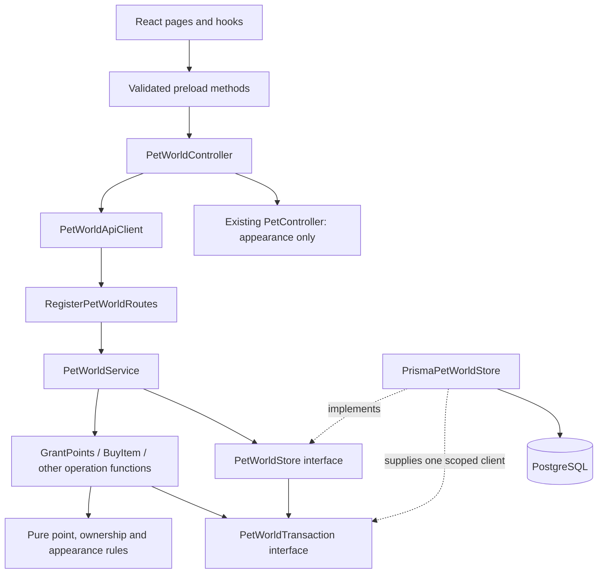

# Pet World engineering spec

> Design reference, October 11, 2026. Written at the user's explicit request for an
> engineering spec. This preserves the proposed design and delivery decisions;
> source ownership and implemented behavior are maintained in Architecture.
> [Architecture](Architecture.md) remains the maintained description of the
> implemented system. The [HTML prototype](../examples/previews/PetLearningLoop.html)
> contains fictional, in-memory interactions and is a visual reference only.

## 1. Product decisions

The feature connects teacher recognition to a student's personal pet world:
teacher awards points → student wallet → cosmetic purchase → home or pet appearance.
Student work and teacher assessment remain the separate source of learning evidence.

The following decisions come from the conversation and are requirements:

- Each student has their own wallet.
- Only a teacher can award points. The backend enforces this permission.
- Teachers choose the amount. There is no teacher-funded wallet, issuance budget,
  daily allowance, weekly allowance or cumulative product cap on awards.
- Students spend their own points on cosmetic items. Purchases become inventory.
- A student owns their home and can choose to show it to classmates.
- The floating pet can display an equipped backdrop, with costumes supported as
  their compatible artwork becomes available.

The following are recommended implementation defaults, rather than additional
user requirements:

- One wallet and one personal world per student account across classes/devices.
  Every teacher award retains its originating class and teacher.
- Use **Points** in the initial UI and `points` in contracts. If the product chooses
  **Seeds**, it is a display name for this same currency, not another balance.
- A wallet starts at zero. A free base home/pet scene is baseline presentation,
  not a welcome point award or a paid inventory item.
- Points and purchased cosmetics do not expire on a timer. Leaving a class does
  not remove the student's wallet or purchased items.
- Purchases are permanent, single-ownership cosmetics. No trading, transfers,
  refunds, cashback, real-money purchases or negative-balance penalties in v1.
- Sharing is private by default and chosen separately for each class. There is no
  public-web neighborhood in v1.
- A class garden initially grows through collective recognition milestones.
  A milestone changes shared scenery; it never credits a student's wallet.

There is no automatic point award for sign-in, streaks, activity completion,
correct answers, AI assessment, pet interactions, elapsed time or garden milestones.
The teacher may choose to recognize these moments through the teacher award flow.

## 2. Initial scope and boundaries

The initial delivery includes manual single/group awards, wallet history, a small
curated catalog, purchases, personal inventory, bounded home decoration slots,
equipped pet backdrops, class sharing and descriptive teacher recognition coverage.
Teacher review and actual student work can be composed alongside recognition.

School-specific catalog availability and class-owned purchased inventory are
different concepts. An item sold through a school catalog could still belong to
the student. v1 implements personal ownership and class garden milestones only.
School organizations, school-specific prices, class wallets, donations, purchased
shared objects, peer messaging, reactions and user-uploaded cosmetic assets are
deferred. Tro currently has class ownership/enrollment; this feature does not
invent a school administration model.

The existing cat/fox pet remains usable while the new world feature is unavailable.
Do not import sibling repositories or create another service, queue or event bus.
The new operations require no model/provider requests.

## 3. Ownership in the codebase

Implement one feature in the existing modular monolith. These are proposed paths:

| Layer            | Owner and responsibility                                                                                                                            |
| ---------------- | --------------------------------------------------------------------------------------------------------------------------------------------------- |
| Public contracts | `src/contracts/PetWorld.ts`: strict commands, replies, point representations, projections, constants and limits                                     |
| Pure rules       | `src/server/features/petWorld/domain/`: point arithmetic, catalog compatibility, decoration slot rules and recognition summaries                    |
| Application      | `PetWorldService.ts` and `PetWorldStore.ts` under `src/server/features/petWorld/application/`: authorized operations and explicit persistence ports |
| HTTP             | `RegisterPetWorldRoutes.ts` under `src/server/features/petWorld/infrastructure/`: authentication, schemas, replies and safe diagnostics             |
| Persistence      | `src/server/persistence/PrismaPetWorldStore.ts` and additive reviewed Prisma migrations                                                             |
| Desktop main     | `PetWorldApiClient.ts` and `PetWorldController.ts` under `src/desktop/main/petWorld/`: authenticated calls, account fences and refresh              |
| Workspace UI     | `src/desktop/renderer/petWorld/`: teacher awards, wallet, catalog, inventory, home and visits                                                       |
| Desktop pet      | Extend the existing pet snapshot/controller/overlay presentation with validated cosmetic IDs                                                        |

Wire through the existing API and desktop composition roots. Domain rules have no
framework, database or I/O imports. Prisma types stay inside persistence adapters.
Contracts use named `as const` vocabulary and runtime schemas; do not introduce
unchecked JSON or `any`.

Class authorization follows the current
[ClassroomService](../src/server/features/classroom/application/ClassroomService.ts).
The Pet World persistence port reads role, class ownership and enrollment through
its transaction-scoped adapter. Do not call another application's nested
transaction to authorize a wallet write.

### Class and interface design

Use classes where an object owns injected dependencies or a lifecycle. Use
readonly records and small functions for wallet, recognition, inventory and world
rules. A database table does not require a matching service class. The wallet
ledger is accounting history; this design does not introduce event sourcing.



| Class / interface               | Responsibility                                                                                                              | Boundary                                                                                      |
| ------------------------------- | --------------------------------------------------------------------------------------------------------------------------- | --------------------------------------------------------------------------------------------- |
| `PetWorldService`               | Dispatch validated commands; own the transaction boundary, idempotent mutation wrapper and post-commit outcomes             | Receives the authenticated actor separately from the command; never trusts a role in the body |
| `PetWorldStore` interface       | Run a complete operation with a transaction-scoped port                                                                     | The only feature port exposing `runAtomically`                                                |
| `PetWorldTransaction` interface | Authorized-data reads and coordinated accounting/world writes using one transaction client                                  | No nested transaction runner, network calls or Prisma types                                   |
| `PrismaPetWorldStore`           | Implement the port, map/validate stored records, enforce conditional writes and retry recognized conflicts including commit | Contains Prisma; does not choose rewards, prices or teacher authority                         |
| `PetWorldApiClient`             | Send authenticated versioned requests and validate replies                                                                  | Contains transport details; never caches a second authoritative balance                       |
| `PetWorldController`            | Fence account lifetimes, retain unresolved intent IDs, refresh snapshots and publish confirmed appearance                   | Reuses the existing pet controller; does not create another pet window owner                  |

Keep one application facade matching the current classroom pattern. Its `execute`
method dispatches; it should not accumulate the implementation of every workflow.
Place each substantial operation in its own focused file:

```text
src/server/features/petWorld/
  application/
    PetWorldService.ts
    PetWorldStore.ts
    PetWorldTransaction.ts
    GrantPoints.ts
    BuyItem.ts
    InitializeWorld.ts
    SetPetProfile.ts
    EquipItem.ts
    PlaceItem.ts
    ReverseGrant.ts
    VoidRecognition.ts
    SetHomeSharing.ts
    ReadOwnWorld.ts
    ReadClassRecognition.ts
    ReadSharedHome.ts
  domain/
    PetWorldState.ts
    PointAmount.ts
    PetWorldAccess.ts
    PetCatalog.ts
    PetAppearance.ts
    HomeSlots.ts
    RecognitionCoverage.ts
    PetWorldError.ts
```

This is a target ownership map, not a request to generate empty files in advance.
Create files as their delivery slice is implemented. A small operation can stay
with a closely related operation until it has a distinct responsibility.

`PetWorldState.ts` owns framework-free persisted domain records. Public wire types
come from the canonical schemas in `src/contracts/PetWorld.ts`; do not copy those
shapes into hooks, API clients or handwritten request interfaces. Derived command
types use `Extract` and the canonical command-kind constants. Prisma-generated
models remain private to the adapter.

The public service surface and key port distinction are explicit in these
proposed signatures. These declarations describe the design; they are not
implemented source. The transaction excerpt shows the grant slice; other
command/read methods are added when needed. Record and reply names refer to
feature-owned types, not generated database models.

```ts
export declare class PetWorldService {
  constructor(store: PetWorldStore, now?: () => Date, createId?: () => string);

  execute(actorId: string, command: PetWorldCommand): Promise<PetWorldReply>;
}

export interface PetWorldStore {
  runAtomically<T>(operation: (transaction: PetWorldTransaction) => Promise<T>): Promise<T>;
}

export interface PetWorldTransaction {
  readGrantAccess(
    actorId: string,
    classId: string,
    studentIds: readonly string[],
  ): Promise<PetGrantAccess>;

  readReceipt(actorId: string, requestId: string): Promise<PetWorldReceipt | null>;

  readWallet(studentId: string): Promise<PetWalletState | null>;

  createWalletIfMissing(studentId: string): Promise<PetWalletState>;

  recordTeacherGrant(grant: TeacherGrantWrite): Promise<void>;

  saveReceipt(receipt: PetWorldReceipt): Promise<void>;
}
```

Inject time and ID functions for deterministic tests; use production defaults at
composition. Capture values for a mutation before its retryable callback so a
database retry cannot produce different recognition IDs or timestamps. Avoid
separate clock and ID service classes for these two functions.

`PetGrantAccess` contains the current account roles, class owner/deleted state and
recipient enrollment facts. `requireTeacherGrantAccess` checks those facts inside
the active transaction. It is not a client-provided authorization token.
`TeacherGrantWrite` ties the recognition, matching positive ledger entry, new
balance and expected wallet revision together. The adapter's `recordTeacherGrant`
persists that prepared change with conditional revision checks. It neither opens
another transaction nor decides that an actor is allowed to award points.

For purchases, add the corresponding `recordPurchase` port operation that writes
the debit, purchase, entitlement and optional revision-checked appearance together.
Do not expose `setBalance`, arbitrary adjustments or an HTTP `creditWallet` command.
Transaction ports are internal collaborators, not extra public endpoints.

Pure functions should have specific names and observable responsibilities:

| Function                                                                    | Responsibility                                                                      |
| --------------------------------------------------------------------------- | ----------------------------------------------------------------------------------- |
| `parsePointAmount` / `formatPointAmount`                                    | Convert canonical decimal strings and checked bigint values at the feature boundary |
| `calculateGrantedBalance`                                                   | Check a positive amount and overflow, returning a new balance                       |
| `calculatePurchaseBalance`                                                  | Check the price and available balance, returning a nonnegative result               |
| `requireTeacherGrantAccess`                                                 | Reject wrong role, class owner, deletion, self/teacher recipients or enrollment     |
| `findCatalogItem` / `requireItemCompatibility`                              | Resolve stable definitions and validate pet/client/category support                 |
| `validateHomeSlotChange`                                                    | Check a typed anchor, category, ownership and placement constraints                 |
| `changePetAppearance`                                                       | Produce a new appearance from owned compatible items without mutating the input     |
| `calculateRecognitionCoverage`                                              | Derive explicitly scoped descriptive coverage from nonvoided records                |
| `buildOwnerWorldView` / `buildClassRecognitionView` / `buildSharedHomeView` | Construct separate allowed projections with explicit fields                         |

The pure balance functions perform arithmetic, not authorization or persistence.
Only the teacher grant operation creates a positive ledger change. Do not add a
`Wallet.credit()` active-record method that writes outside the authorized workflow.
Do not create `Student extends User`, item subclasses for each cosmetic, generic
CRUD repositories, a shared `BaseService` or a configurable reward-rule engine.
Use catalog data for cosmetic variation and named functions for actual rules.

The mutation call sequence is:

1. Route authenticates the request and parses the canonical command schema.
2. `PetWorldService` prepares the canonical digest and stable server IDs/time for
   this attempt, then enters `store.runAtomically` once.
3. If a matching receipt exists, authorize access to that historical resource,
   check its digest and return the original outcome. Do not run current-recipient
   grant checks against a completed award replay.
4. Otherwise dispatch to a focused operation such as `grantPoints`. It reads
   current access, validates rules, prepares the coordinated writes and calls the
   transaction port. Group recipients use the same transaction throughout.
5. The facade saves the receipt before commit. A failed receipt write rolls back
   the corresponding award/purchase too.
6. After a successful commit, return the validated result and perform any local
   refresh notification. No notification or external effect occurs inside a
   transaction callback that may retry.

Owner, teacher and visitor reads also authorize and select data in a consistent
read scope. Build visitor responses from allowed cosmetic fields; never spread
the owner response and delete private properties afterward. Classroom enrollment
revocation/deletion invalidates shares using its existing transaction client,
without a circular call from `ClassroomService` into `PetWorldService`.

There is no separate `WalletService`, `InventoryService` or `ShopService` opening
its own transaction. A single purchase coordinates all three responsibilities.
If this feature grows, split operation files and narrow their accepted transaction
methods before introducing another service boundary.

The desktop API client and controller similarly stay separate: transport validates
JSON, while the controller owns cancellation, revisions, account generation and
pending intents. React hooks consume typed snapshots and call named actions;
components do not calculate authoritative balances or call persistence. The
renderer uses narrow named preload methods and main validates the sender and
payload. The existing `PetController` remains the sole pet lifecycle owner.

Test the design at three seams: pure rules for amounts/access/compatibility;
service operations with a typed store fake for business rejections and receipts;
and real disposable PostgreSQL for constraints, rollback and concurrency. A fake
cannot establish database serializability. Tests should assert the externally
meaningful state/invariants, not the exact order of harmless helper calls.

## 4. Permissions

The server obtains the actor from the authenticated session. Commands never accept
an authoritative `teacherId`, `actorId`, role or wallet owner supplied by the client.

| Actor                                                    | Allowed                                                                                                                |
| -------------------------------------------------------- | ---------------------------------------------------------------------------------------------------------------------- |
| Student world owner                                      | Read own wallet/entries/inventory/world; buy for self; place/equip owned items; choose own class sharing               |
| Current teacher owning a nondeleted class                | Award that class's currently enrolled student-role accounts; read that class's award history; correct their own awards |
| Currently enrolled classmate                             | Read the cosmetic projection of an opted-in, currently enrolled classmate's world                                      |
| Current owning teacher visiting a class                  | Read the same cosmetic visitor projection for homes shared with that class                                             |
| Student, unrelated teacher, worker, model, scheduled job | No point issuance                                                                                                      |

For every new grant, verify the actor's current backend teacher role, ownership of
the nondeleted class, and each recipient's current student role and active
enrollment inside the same database transaction as the credit. A teacher cannot
award themselves or any teacher-role account. Student presence, a joined-device
lease and an open desktop are not prerequisites for receiving a classroom award.

A promoted student keeps their existing owner data and may use it as its owner;
role changes do not reset the world. Their teacher role cannot be used to award
their own wallet. New wallets are initialized for student accounts only; an
existing teacher's local pet does not require a points wallet. A student with an
existing wallet may initialize its world even if their account was promoted
before the first world visit.

The teacher award controls use the normal authenticated teacher HTTP flow. Do not
expose award commands through agent tools, MCP, workers, student practice tools or
provider callbacks. A session proves account authority; it does not itself prove
that a physical human clicked, so do not claim cryptographic proof of human intent.

Teachers see the amounts and recipients of awards in their own class. This does
not grant access to the student's account-wide balance, other-class awards,
purchases or spending history.

## 5. Persistence model

The following records are logical boundaries; implementation may combine tightly
coupled profile/appearance columns without weakening their ownership or constraints.

| Record                     | Important fields and constraints                                                                                                                             |
| -------------------------- | ------------------------------------------------------------------------------------------------------------------------------------------------------------ |
| `PetWallet`                | Unique `studentId`, nonnegative `balance`, monotonic `revision`; initialized at zero                                                                         |
| `PetWalletEntry`           | ID, wallet owner, signed delta, kind, source ID, request ID and server time; append-only; unique source operation per wallet                                 |
| `PetRecognition`           | ID, class, issuing teacher, student, batch ID, positive amount, category, optional note/session/activity references and server time                          |
| `PetRecognitionCorrection` | Recognition ID, issuing teacher, correction kind/reason and server time; append-only; at most one void per recognition                                       |
| `PetPurchase`              | ID, student, stable item ID, paid amount, catalog revision, request ID and server time                                                                       |
| `PetInventoryItem`         | Unique `(studentId, itemId)`, purchase ID and acquisition time; permanent entitlement in v1                                                                  |
| `PetWorld`                 | Unique student, synced selected pet ID and names keyed by supported pet ID, validated home slot assignments, equipped backdrop/outfit and monotonic revision |
| `PetHomeShare`             | `(studentId, classId)`, enabled state and revision; never a single global public/private flag                                                                |
| `PetWorldReceipt`          | Unique `(actorId, requestId)`, command digest/version, authorized resource scope and immutable successful result                                             |

Wallet entry kinds in v1 are `TEACHER_GRANT`, `PURCHASE` and `GRANT_REVERSAL`.
Only `TEACHER_GRANT` has a positive delta, with a required matching recognition and
teacher provenance. There is no generic credit, reward bonus, admin mint or balance
setter endpoint. A zero wallet initialization creates no credit entry.

Use foreign keys and unique constraints for source relationships and ownership,
plus reviewed database constraints for nonnegative balances and permitted delta
signs. Application rules and integration tests also enforce the cross-record
invariants. All writes use the transaction-scoped Prisma client.

### Point representation

Amounts are positive whole points; wallet balances are whole nonnegative points.
Use PostgreSQL `BIGINT`, Prisma `BigInt` and checked bigint arithmetic in owned
application code. JSON transports decimal strings, for example `"50"`; it never
serializes a JavaScript `bigint` directly or uses floating-point money arithmetic.

Commands accept canonical unsigned decimal strings without signs, fractions,
exponents, whitespace, leading zeros or implicit numeric coercion. Grant amounts
and catalog prices must be greater than zero. Balance replies may contain `"0"`.
Validate the signed 64-bit database range and reject a result that would overflow;
never clamp, wrap or round. This is a storage correctness boundary, not an award
budget. Request sizes and recipient counts are bounded for service reliability,
without imposing a daily/weekly point allowance.

The accounting invariant is:

`wallet.balance = sum(committed wallet entry deltas)`, with `wallet.balance >= 0`.

Use deterministic replay fixtures and a read-only reconciliation check to detect a
mismatch. Do not repair balances by silently creating a credit or editing history.

## 6. Commands and transaction rules

### Grant points

Input: request ID, class ID, unique recipient IDs, positive point amount per
recipient, recognition category and optional note/context references. Suggested
categories are curiosity, persistence, explanation, contribution and other. The
category is teacher recognition, not a correctness or mastery label.

Quick buttons may offer 5/10/20 points; custom whole-point amounts are equally
supported. The UI shows **points per student**, recipient count and the resulting
total before submission. A large amount is not rejected by a product quota.

In one serializable transaction:

1. Check authentication-derived authority and request receipt semantics.
2. Verify every recipient and context reference belongs to the permitted class.
   Reject duplicate IDs rather than multiplying the award.
3. Create missing student wallets at zero idempotently. Do not initialize pet
   profiles from a teacher grant; the student's local pet may not have synced yet.
4. Create one recognition and positive entry per recipient, sharing one batch ID.
5. Increment each balance/revision with checked arithmetic.
6. Save the successful receipt.

All recipients succeed or none do. An invalid recipient, overflow, conflict
exhaustion or persistence failure leaves no partial batch or success receipt.
Concurrent role/enrollment changes and grants must have a consistent serializable
order. A grant ordered after loss of authority is refused.

The teacher reply contains batch/recognition IDs, recipients, awarded amounts and
commit time. It contains no recipients' account-wide wallet snapshots. Notify or
refresh clients only after commit.

### Buy an item

Input: request ID, item ID, displayed catalog revision/price and optional
`equipAfterPurchase`. Purchases require an initialized world for pet compatibility;
if equipping, also require its `expectedWorldRevision`. The recipient is always
the authenticated wallet owner.

Within one transaction, validate current catalog availability, compatible pet/client
assets and displayed price; require sufficient balance and no existing ownership;
debit the server-owned price; append the negative entry; create purchase and
inventory rows; optionally equip; increment affected revisions; save the receipt.

A changed price/catalog returns a conflict and refreshed display information; it
does not silently charge a new price. The submitted price is a comparison guard,
never the authoritative price. Delisted items cannot be bought but remain usable
by their existing owners. Stable item IDs are never reassigned to different goods.

Two purchases cannot overspend the same wallet. Two distinct requests for one
item produce one purchase and one already-owned result. A failed purchase creates
no debit, ownership or equipped state. A stale world revision when buying-and-equipping
aborts the entire purchase without charging; the UI may refresh and let the owner
submit a new intent, or offer purchase without equipping. Buying alone does not
change world appearance/revision. No refund command exists in v1.

### Initialize or update the pet profile

`initialize-world` is an owner-only, idempotent mutation. A current student may
create a zero wallet and an initial world in one transaction; an account with an
existing wallet may initialize its missing world. It accepts only the validated
bundled pet selection and names from local preferences, plus request ID. It
accepts no point balance, inventory, sharing or purchased cosmetic claims. Reads
of a wallet/history work without a world and report that initialization is needed.

Create the profile only if absent. Concurrent initializations or another device's
existing profile return the authoritative existing world rather than overwriting
it. An award or database migration cannot preempt this one-time local pet import.

`set-pet-profile` is an owner-only mutation with request ID and expected world
revision. It updates the selected bundled pet and/or that pet's name, preserving
names saved for other supported pets. Changing species automatically unequips
incompatible outfit/backdrop IDs in the same transaction, preserving their
inventory ownership. Compatible home decorations stay placed. This changes no
point balance and cannot adopt a paid catalog cosmetic without purchase.

### Equip and decorate

Input: request ID, expected world revision and a bounded typed slot change.
The server checks ownership, category and pet compatibility. One backdrop and one
outfit can be equipped; an empty selection removes them at no cost. Home slots
accept only home/garden items. Backdrop IDs never enter home decoration slots.

Use named home anchors/slots in v1, not arbitrary HTML, CSS, file paths or free-form
geometry. Removing a decoration or backdrop preserves its inventory entitlement.
A stale revision returns a conflict; do not silently overwrite another device's
layout. Equipping/removing owned items changes no wallet entry.

### Correct a mistaken award

Only the original issuing teacher, still authorized for the nondeleted class, can
correct their own grant. Current recipient enrollment is not required to correct
a historical grant. No arbitrary student debit or negative award is supported.

- `reverse-grant` appends a debit for the exact original amount and a void
  correction in one transaction. It requires enough current balance, has a unique
  reversal source, and can succeed only once.
- If the balance is insufficient, return a specific failure without changing
  money or items. The teacher may instead use `void-recognition` with a reason.
  This marks the recognition mistaken while explicitly leaving the wallet and
  purchases as they are. It never adds points.
- A recognition-only void is final in v1; it cannot later be used to debit the
  wallet. Both correction flows preserve the original award and show whether
  points were reversed. Voided recognition is excluded from recognition coverage
  and garden milestone calculations.

There are no negative balances, forced item confiscations or replacement point
credits. Corrections are deliberate teacher actions, not classroom punishment.

### Share a home

Input: request ID, class ID, enabled state and expected share revision. The actor
owns the home and is currently enrolled in the nondeleted class. Save only that
class's consent. Unsharing does not affect the home, inventory or other classes.

Enrollment revocation or class deletion disables the corresponding shares in its
own source transaction. Re-enrollment starts with sharing disabled, avoiding
revival of an old opt-in. Every neighborhood/visit read still checks current
membership and consent; a missed invalidation cannot authorize a visit.

## 7. Idempotency, ordering and failure handling

Every mutation has a client-generated UUID `requestId` for one logical intent.
Network retry reuses it. Editing an amount, recipient list or purchase creates a
new intent and ID. Main retains an unresolved intent under its account fence so a
timeout is retried or reconciled with the same ID rather than submitted anew.

Build a versioned canonical digest from validated fields in fixed field order,
including command kind, scope, amount, category, normalized note, item/price,
expected revision and equip intent as applicable. Sort the validated unique
recipient set so input order does not change group semantics.

The same actor/key/digest returns the original committed outcome. The same key
with different content fails with `REQUEST_CONFLICT`. Concurrent matching keys
converge on one committed operation. Retain minimal deduplication receipts for
the lifetime of the corresponding accounting history; do not expire them on a
short cache TTL and risk replaying an old grant.

Replays require current authorization to read the receipt's resource. For a grant
already committed, returning its receipt does not require the recipients still
be enrolled; it creates no new credit. Revoked teacher/class authority cannot use
an old receipt to bypass access control. Owner receipts require the same owner.

Receipts describe the original outcome. They may contain older owner revisions
than the latest snapshot. The client shows the action outcome but never replaces
a newer wallet/world with older receipt data; it fetches current state as needed.
Server revisions are distinct from local pet presentation revisions.

Reuse the bounded serializable transaction retry pattern demonstrated by
[RetryClassroomTransaction](../src/server/persistence/RetryClassroomTransaction.ts).
Retry only recognized database conflicts and the complete transaction including
commit. Resolve ownership/receipt uniqueness races deliberately. Do not retry
validation or permission errors, or make network/model calls inside transactions.

## 8. API and desktop boundaries

Proposed versioned endpoint: `POST /api/v1/pet-world/command`, with discriminated
strict request/reply schemas consistent with existing classroom commands.

| Operation                              | Scope                                                                                                                           |
| -------------------------------------- | ------------------------------------------------------------------------------------------------------------------------------- |
| `read-own-world`                       | Authenticated owner; current wallet, inventory, optional world and revisions; missing world is an explicit initialization state |
| `read-own-history`                     | Owner-only paginated wallet/recognition history                                                                                 |
| `read-catalog`                         | Compatible purchasable items, displayed prices and catalog revision                                                             |
| `read-class-recognition`               | Current owning teacher; only the selected class's awards/corrections/coverage                                                   |
| `grant-points`                         | Teacher-only, authorized class recipients                                                                                       |
| `reverse-grant`, `void-recognition`    | Original authorized teacher and exact grant                                                                                     |
| `initialize-world`, `set-pet-profile`  | Owner-only baseline/profile changes; no point credit or inventory claims                                                        |
| `buy-item`, `equip-item`, `place-item` | Owner-only; validated item/slot intent                                                                                          |
| `set-home-sharing`                     | Owner-only class consent                                                                                                        |
| `read-neighborhood`, `visit-home`      | Current class access plus target's current membership/consent                                                                   |
| `read-command-result`                  | Authorized actor's original intent outcome or an explicit not-found result                                                      |

Example proposed award body:

```json
{
  "kind": "grant-points",
  "requestId": "cc3f8f62-a16e-4d32-ae11-83a1cb855fa9",
  "classId": "13d38453-cada-4b3e-bad7-24d312721120",
  "studentIds": ["student-account-id"],
  "pointsPerStudent": "50",
  "category": "persistence",
  "note": "Tried another approach and explained what changed."
}
```

`read-command-result` returning not-found is not proof that another in-flight
request cannot commit. Retry the original intent/key; never turn that result into
a fresh grant request ID automatically.

Define stable failures including unauthorized, forbidden, invalid, request conflict,
stale version/catalog, insufficient points, already owned, incompatible item,
unshared/unavailable home, reversal unavailable and temporary unavailability.
Map authentication to 401, permission failures to 403, malformed input to 400,
state conflicts to 409 and exhausted transient persistence failures to 503.
Private target existence must not leak through differently detailed failures.

Keep payload/recipient/note/page/slot sizes bounded in the owning contract. Reject
oversized requests before beginning writes. Private replies use `Cache-Control:
no-store`. Account/session cookies stay in Electron main. Renderer-to-main methods
are named, runtime-validated and sender-checked; no generic HTTP/IPC capability.

## 9. Read projections and privacy

Never return an owner's full world response for a visit and hide private fields
with CSS. Define separate strict projections:

- **Owner:** own balance, wallet entries, recognition memories, inventory,
  decorations, equipped appearance and own sharing settings.
- **Teacher:** own class's recipients, issued awards, categories, corrections,
  dates and descriptive coverage. No global student balance or purchase history.
- **Visitor:** approved display name, pet, bounded home slots and equipped
  cosmetics. No account email, wallet, notes, responses, work evidence, journal,
  other-class identifiers or mutation controls.
- **Pet overlay:** pet identity/name, approved appearance IDs and local motion/
  presentation settings. No wallet, class permissions or learning content.

Paginated cursors bind the actor, class, filters and relevant revisions. Each page
and visit rechecks access. A student or class change clears visible private state,
closes visits and fences stale replies. Previously viewed pixels cannot be recalled;
the application must cease displaying/refetching a revoked visit when it learns of
the change, on refresh/resume, or through a failed authorization check.

Recognition notes are private content stored outside the minimal point ledger.
Use an explicit retention/removal policy aligned with the existing classroom
content lifecycle. A decoration references a recognition ID, not a copied student
response or screenshot. If its recognition content expires/is removed, display
the decoration without the private memory. Accounting and ownership do not
depend on retaining private prose. No private content is copied into class visits.

## 10. Catalog, world and floating pet

Keep the first catalog server-owned and versioned, backed by approved bundled
artwork. Each definition includes a stable ID, localized labels, point price,
category, supported pet IDs, slot compatibility and required asset capability.
The desktop reports supported catalog assets/version; the server offers purchases
the client can render. An unexpected cosmetic ID falls back to a plain pet/scene.

Retired owned assets remain renderable. Preserve item IDs and asset compatibility
across updates. Do not accept remote asset URLs, student HTML/SVG or filesystem
paths through a catalog command. The HTML draft's fixed scarf is not evidence
that a costume aligns with every animation pose.

Move the world pet's identity/names and equipped cosmetics into the synced owner
profile. Device preferences retain overlay position, enabled/hidden state, quiet
mode, locale and reduced-motion choice. Preserve existing pets/names during the
upgrade: create the initial cloud profile from validated local defaults only if
no profile exists; an existing cloud profile wins. Never overwrite it with a
late local read or repeatedly import local preferences on each sign-in. Import
the complete validated cat/fox name map so switching pets does not lose the
inactive pet's saved name. Route the existing world owner's pet picker/name edits
through `set-pet-profile`; local-only teacher pets retain their existing flow.

Main fetches a validated appearance projection and publishes it through the
existing [PetController](../src/desktop/main/pets/PetController.ts),
[PetPreload](../src/desktop/preload/PetPreload.ts) and
[PetOverlay](../src/desktop/renderer/pets/PetOverlay.tsx). Purchases occur in the
workspace UI; the restricted non-focusable overlay has no purchase/grant capability.

Start with passive backdrops. Keep the visible background click-through around
the pet. Any enlarged overlay requires coordinated window size, placement,
hit-region and CSS changes; changing only CSS is insufficient. Preserve hiding
during existing work/voice states and reduced-motion behavior. Add outfits using
compatible pose/reaction sheets or a verified accessory adapter.

## 11. Synchronization and offline behavior

The database is authoritative. Refresh on sign-in, world entry, focus/resume and
successful mutation. Use bounded polling while the world or companion is active
for the initial version, with a proposed 15-second refresh interval owned by the
future contract/controller constant. Stop inactive polling; avoid per-frame network
work. Missed wakeups are repaired by fetching the authoritative snapshot.

Grant replies do not push private student balances to teachers. The receiving
student refreshes their own snapshot. A grant creates a recognition memory and
balance change, not an automatic pet emotion or learning verdict.

Fence requests/cache by account identity and generation, and class where relevant.
Signing out/switching accounts clears the prior presentation before accepting a
new one. Late responses from the old account cannot repopulate any view or pet.

Allow the last confirmed account-scoped cosmetic appearance offline. Clearly show
wallet data as last synchronized if displayed offline. Grants, purchases, profile
changes, placements/equipment changes and sharing require a successful online commit in
v1. Do not optimistically credit/debit points or queue new offline awards.
Persist unresolved online intent IDs under the account boundary for reconnect/
restart reconciliation; never replay them under another account.

After a world revision changes, refresh an open visitor's cosmetic projection;
permission loss closes it. Live multi-instance streaming is a later measured need,
not a prerequisite for ledger correctness.

## 12. Recognition and learning feedback

Compose class recognition coverage beside existing learning insights. Keep
[CalculateStudentProgress](../src/server/features/classroom/domain/CalculateStudentProgress.ts)
and assessment criteria independent of point awards/spending.

Coverage means students with a recorded, nonvoided recognition during a selected
period. Display the source/window/eligible roster explicitly; missing recognition
does not establish disengagement. Different point amounts are teacher choices,
not comparable measures of ability, attention or motivation. No wealth ranking.

For a class garden, count recognized classroom moments rather than point totals,
so a very large award does not buy class progress. A group batch counts as one
classroom moment if at least one recognition in it remains nonvoided. Reversing/
voiding all its recognitions removes that moment. Calculate the current garden
milestone deterministically; this has no wallet credit side effect.

“Teach my pet” attaches to an approved activity and the existing practice/teacher
review path. Actual evidence, support context and teacher assessment remain owned
by that system. Help is available without points. Submitting or being marked
correct never awards points automatically; a teacher must separately choose a
grant. Cosmetic purchases do not update learning progress or parent report facts.

## 13. Diagnostics and lifecycle

Emit bounded operation/result, request/receipt IDs, safe resource IDs, revisions,
timing and rejection categories. Record atomic retry exhaustion at the persistence
boundary. Ordinary logs contain no cookies, raw command bodies, notes, student
responses, screenshots, assets or hidden model reasoning. Routine successful polls
remain quiet. Database recognition/accounting records provide the audit history.

Additive migrations create the new tables without initializing pet profiles or
inventing prior grants. Wallets are created at zero on the first authorized grant
or owner initialization; world profiles are created only by owner initialization.
Do not import HTML demo balances or create rewards from historical practice checks.
Do not reset existing data. Runtime starts/tests without private providers; integration
tests may use disposable PostgreSQL. Deployment remains a separate authorized action.

Class withdrawal/deletion prevents new grants/visits and disables that class's
sharing. Existing personal entitlements remain; class records follow the existing
history/removal lifecycle. Account content removal must scrub private recognition
prose and derived memory views without issuing points or silently rewriting totals.

## 14. Delivery and acceptance

Implement and review complete slices in this order:

1. Teacher-only grant, wallet/ledger, receipts and teacher/student read projections.
2. Owner profile initialization/local preference migration, catalog, atomic
   purchase, inventory and private world decoration/equipment.
3. Real floating-pet backdrops connected to the synced owner profile.
4. Per-class opt-in visits, membership invalidation and class garden scenery.
5. Recognition coverage beside actual work and the teach-pet review entry point.

The first cross-device demonstration is: an owning teacher awards 50 points;
the student sees 50, buys a 20-point backdrop, keeps 30 and sees the real floating
pet update. Retrying the award or purchase changes nothing a second time. This
requires two simultaneous signed-in clients; sequential account switching alone
does not establish cross-device behavior.

| Acceptance area      | Required evidence                                                                                                                                                                                                  |
| -------------------- | ------------------------------------------------------------------------------------------------------------------------------------------------------------------------------------------------------------------ |
| Only teachers issue  | Student/worker/model/job flows cannot create a positive entry; spoofed actor/role fields are rejected; role assignment and baseline creation create no points                                                      |
| Teacher scope        | Other-class teachers, downgraded teachers, self/teacher recipients, inactive enrollment and deleted classes are refused without writes                                                                             |
| Unrestricted awards  | Custom whole-point amounts work without a teacher budget or daily/weekly cap; invalid/overflow values fail atomically without clamping                                                                             |
| Group awards         | One invalid or duplicate recipient aborts the batch; no partial recognition/entry/balance/receipt survives failure                                                                                                 |
| Idempotency          | Timeout/restart retry and concurrent identical keys create one operation; changed content on the same key conflicts; old receipts cannot replace newer UI state                                                    |
| Accounting           | Concurrent grants/purchases/reversals preserve the balance-sum invariant; insufficient balance never becomes negative; one item cannot charge twice                                                                |
| Correction           | Reversal occurs once, spends no purchased item, and fails cleanly below balance; a recognition-only void changes no balance and cannot later debit it                                                              |
| Catalog/world        | Server price wins; changed price needs a fresh reviewed purchase; delisted owned items work; unknown assets degrade safely; slot/category/pet compatibility is enforced                                            |
| Profile migration    | An award before the student's first world visit preserves their local pet and all saved names; concurrent initialization never overwrites an existing profile; changing species clears only incompatible equipment |
| Buy and equip        | A stale expected world revision aborts purchase and equip together with no debit; a purchase without equipping cannot overwrite appearance                                                                         |
| Privacy              | Direct owner/teacher/visitor API tests prove that balances, cross-class history, notes and evidence cannot leak; unauthorized IDs/cursors fail                                                                     |
| Sharing              | Private by default; per-class opt-in; unshare/revocation/deletion closes access; re-enrollment does not restore old consent                                                                                        |
| Account/device races | Delayed old-account and out-of-order responses cannot restore stale balance, world, visit or overlay; offline commands cannot mint/spend                                                                           |
| Learning separation  | Awards, purchases and garden milestones do not create assessments/mastery or automatic credits; expired memory content leaves its cosmetic intact                                                                  |
| Native pet           | macOS/Windows hardware checks cover click-through, dragging, focus, fullscreen, scale/monitor changes, account switch, restart and reduced motion                                                                  |

Use focused pure-rule/contract/service tests, API permission tests and disposable
PostgreSQL integration tests for actual uniqueness/serializable behavior. Renderer/
preload/main tests cover projection shape, account fences and appearance delivery.
Use synthetic providers; no paid inference is necessary. Finish implementation
before running final validation. The required commands and hardware procedures
remain owned by the [README](../README.md#validation).

When each slice is implemented, update the implemented ownership/communication
description in `Architecture.md` and retire the corresponding proposal text rather
than maintaining conflicting descriptions. This spec alone does not change runtime.
